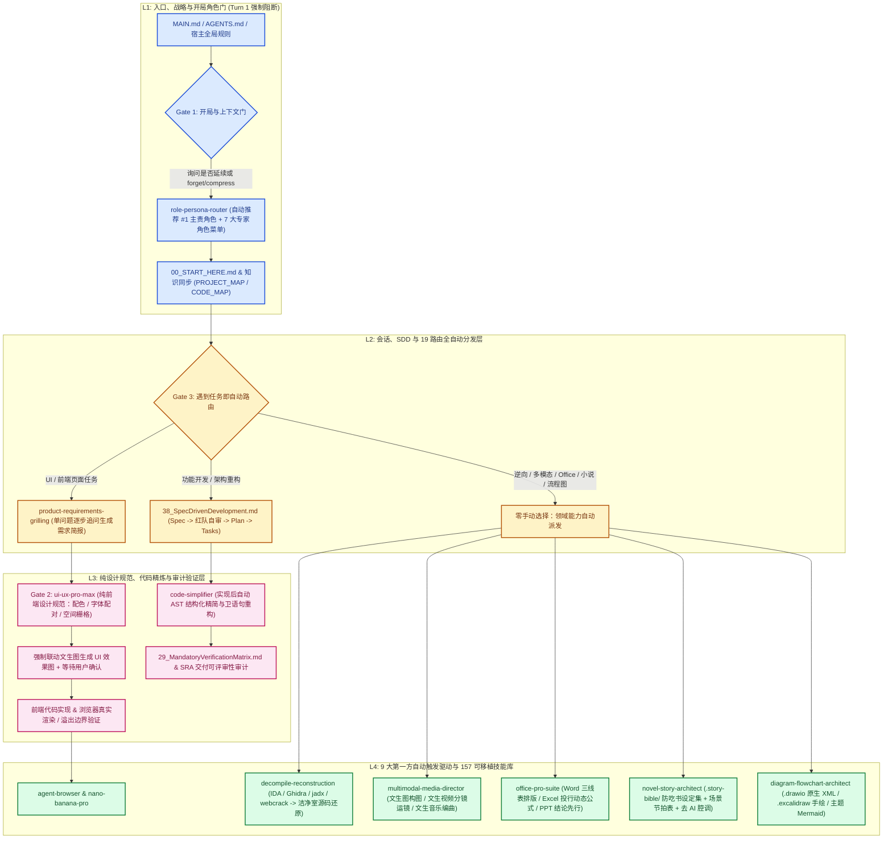
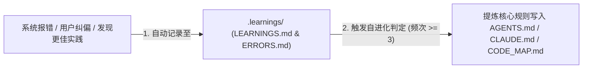

<!--
MANDATORY LOGIC GATE

Before making changes here, read `AGENTS.md` and `README.md` first.
Then follow the repository-declared logic entry chain, including `00_START_HERE.md`,
`modules/01_MasterLogic.md`, and `modules/15_LogicEntryChecklist.md` when applicable.

Before every new coding round, explicitly decide whether the current task extends
the previous coding round.
If it does not, explicitly ask whether to forget/compress context before continuing.

Treat this flow as a blocking gate, not as guidance, documentation, or a reminder.
Do not infer continuation by yourself.
Do not skip the context-reset question for efficiency.

Do not continue deeper reading, modify files, delete files, perform write actions,
or begin implementation before the logic-entry loop above has been completed.
-->

> `README.md` is the canonical English repository README and entry documentation. This file is retained as a legacy/reference document and is not part of the formal logic-entry chain.

# 🌌 AgentLogic: 智能体级本地自进化规则引擎 (V6.9.1)

AgentLogic 是一套专为本地 AI 编码宿主（**Antigravity / Gemini**、**Claude Code**、**OpenAI Codex / GPT**）设计的**分层自进化规则引擎**。它将多轮会话规范、**开局角色自主推荐门（Turn 1 Role Gate）**、**纯前端 UI/UX 设计与文生图强制联动门**、**遇到即自动触发的 9 大第一方专业领域技能**、安全沙箱审计及项目知识同步集成打包，作为 AI 智能体的“主运行心智”。

> [!IMPORTANT]
> **开发前置卡点**：本仓库是逻辑基础设施，而非普通的业务项目。
> 在进行任何逻辑修改或新项目绑定前，AI 智能体**必须**以 `00_START_HERE.md` 为起点，完成完整的逻辑链闭环自检。

---

## 🚀 快速启动与跨宿主部署

对于本地环境的诊断与跨宿主部署（支持 `antigravity`、`claude`、`codex`），请执行以下指令：

| 操作步骤 | 运行指令 (PowerShell) | 核心作用 |
| :--- | :--- | :--- |
| **1. 环境诊断** | `powershell -NoProfile -ExecutionPolicy Bypass -File .\scripts\doctor.ps1` | 检测仓库健康度，读取元数据，生成推荐安装指令 |
| **2. 一键安装** | `powershell -NoProfile -ExecutionPolicy Bypass -File .\install.ps1 -TargetHost antigravity` | 构建并部署宿主规则包及 9 个第一方自动触发 Skill（可将 `antigravity` 替换为 `claude` 或 `codex`） |
| **3. 本地验证** | `powershell -NoProfile -ExecutionPolicy Bypass -File .\scripts\maintainer-check.ps1` | 运行 157 个注册技能、19 条自动路由、34 项外部引用及四层架构完整性校验 |

---

## 🏛️ 架构矩阵与 V6.9 全自动触发流程图 (4-Layer Grid & Auto-Routing Flow)

本仓库拒绝线性的规则堆砌，将所有模块按**四层抽象 + 三大强制阻断门**进行分级治理，实现“遇到对应任务即自动触发对应技能，零手动指定”：

### 模块详细清单

| 抽象层级 | 核心职责 | 包含的规则文件 / 目录 |
| :--- | :--- | :--- |
| **L1: Strategy & Entry** (战略与入口层) | 确立 AI 起手式、开局上下文确认、开局角色自主推荐（`role-persona-router`）及项目知识同步。 | - [00_START_HERE.md](./00_START_HERE.md) (起手式) - [MAIN.md](./MAIN.md) (宿主绑定入口) - [AGENTS.md](./AGENTS.md) (智能体规范) - [15_LogicEntryChecklist.md](./modules/15_LogicEntryChecklist.md) (自检清单) - [54_V6_9_RoleAndMultimodalCreativeGovernance.md](./modules/54_V6_9_RoleAndMultimodalCreativeGovernance.md) (V6.9 角色与多模态治理) |
| **L2: Session & Loop** (会话与循环层) | 规范多轮对话中的单问题需求澄清、SDD 六阶段规格驱动及 19 条自动任务路由。 | - [03_AgenticLoop.md](./modules/03_AgenticLoop.md) (执行循环) - [38_SpecDrivenDevelopment.md](./modules/38_V6_6_SpecDrivenDevelopment.md) (SDD 规格驱动六阶段) - [48_V6_8_SkillAndToolRouting.md](./modules/48_V6_8_SkillAndToolRouting.md) (技能与工具自动路由) - [53_V6_8_ProgrammingLevelSkillEnforcement.md](./modules/53_V6_8_ProgrammingLevelSkillEnforcement.md) (编程级技能强制状态机) |
| **L3: Control & Auditing** (执行与控制层) | 执行纯 UI 设计规范 + 文生图前置确认、代码实现后自动精简（`code-simplifier`）及验证矩阵。 | - [29_MandatoryVerificationMatrix.md](./modules/29_MandatoryVerificationMatrix.md) (强验证矩阵) - [39_TasteFrontendDesign.md](./modules/39_V6_6_TasteFrontendDesign.md) (视觉品味与 UI 审计) - [30_ToolQuestionBoundaryMatrix.md](./modules/30_ToolQuestionBoundaryMatrix.md) (提问凭证边界) - [31_ToolMisuseAndAntiPatternMatrix.md](./modules/31_ToolMisuseAndAntiPatternMatrix.md) (反模式纠偏) |
| **L4: Drivers & Skills** (基底与驱动层) | 自动同步部署到三大宿主的 **9 大第一方自动触发技能** 与 **157 个注册可移植技能**。 | - `skills/` (9 大第一方自动触发技能 + 157 个可移植技能)   * [role-persona-router](./skills/productivity/role-persona-router/) (开局角色自主推荐与 7 大角色菜单)   * [product-requirements-grilling](./skills/productivity/product-requirements-grilling/) (单问题交互式需求追问)   * [ui-ux-pro-max](./skills/design/ui-ux-pro-max/) (纯前端 UI/UX 设计规范 + 文生图强制联动)   * [multimodal-media-director](./skills/creative/multimodal-media-director/) (文生图 / 文生视频分镜 / 文生音乐编曲导演)   * [office-pro-suite](./skills/productivity/office-pro-suite/) (Word / Excel / PPT 专业化设计与规范化)   * [novel-story-architect](./skills/creative/novel-story-architect/) (`.story-bible/` 设定集防吃书与去 AI 味长篇小说引擎)   * [diagram-flowchart-architect](./skills/engineering/diagram-flowchart-architect/) (`.drawio` / `.excalidraw` / 主题 `Mermaid` 架构流程图)   * [code-simplifier](./skills/engineering/code-simplifier/) (实现后自动代码精炼与 AST 改写)   * [decompile-reconstruction](./skills/engineering/decompile-reconstruction/) (二进制/字节码/混淆包自动反编译与洁净室源码还原) |

---

## 🛠️ 自学习与持续进化规约

本系统不仅是被动规则，更具备**动态自纠错与沉淀能力**：

> [!TIP]
> **纯前端设计规范 + 文生图前置确认门 (`ui-ux-pro-max`)**：在开发任何新建界面或大幅重构 UI 时，本规则强制先完成单问题需求澄清，再通过 `ui-ux-pro-max` 生成纯设计规范（行业色彩、字体配对、空间栅格），并**强制联动文生图模型生成 UI 视觉效果图**，经您确认后才允许开始编写前端代码。

---

## 📚 外部参考与借鉴项目

AgentLogic 的演进离不开开源社区的启发。我们在设计中深度参考了以下优秀项目：

| 开源项目名称 | GitHub 仓库 / 文档地址 | 核心借鉴与贡献点 |
| :--- | :--- | :--- |
| **Linux Kernel Map** | [makelinux/linux_kernel_map](https://github.com/makelinux/linux_kernel_map) | 启发了四层矩阵式地图结构 ([40_AgentLogicSystemMap.md](./modules/40_AgentLogicSystemMap.md)) |
| **Agent Browser** | [vercel-labs/agent-browser](https://github.com/vercel-labs/agent-browser) | 提供了智能体级别的 AOM 无头浏览器交互方案 |
| **Nano Banana Pro** | [google-gemini/imagen](https://ai.google.dev/) | 带来了多模态前置视觉确认与审美升级工作流 |
| **Self-Improvement Agent** | [peterskoett/self-improving-agent](https://github.com/peterskoett/self-improving-agent) | 贡献了结构化日志自省与频发规则沉淀自进化框架 |
| **Spec Kit** | [github/spec-kit](https://github.com/github/spec-kit) | SDD 规格驱动开发周期设计与质量契约自检 |
| **Taste Skill** | [Leonxlnx/taste-skill](https://github.com/Leonxlnx/taste-skill) | 物理弹簧运动、色彩明度标准与防 slop 排版规范 |
| **PM Skills (AI Shipping)** | [phuryn/pm-skills](https://github.com/phuryn/pm-skills) | 引入 AI 交付与可评审性审计 (SRA) 机制，规范 vibe-coded 交付件 |
| **Ponytail (Lazy Dev)** | [DietrichGebert/ponytail](https://github.com/DietrichGebert/ponytail) | 引入 7 步“最懒资深开发阶梯”（YAGNI、复用优先、原生优先）防代码膨胀 |
| **Matt Pocock Skills** | [mattpocock/skills](https://github.com/mattpocock/skills) | 引入交互式单步 Grilling 拷问、`CONTEXT.md` 通用领域词汇表与 ADR 决策记录 |
| **Cybersecurity Skills Router** | [zhaoxuya520/reverse-skill](https://github.com/zhaoxuya520/reverse-skill) | 引入恶意软件分析、APK 逆向、前端反混淆解密和固件审计技能调度 |
| **Grok Build (对照参考)** | [xai-org/grok-build](https://github.com/xai-org/grok-build) | 对照分析服务商中立的运行时执行、状态保留压缩以及安全拒绝覆盖策略 |
| **Graphify（外部代码地图参考）** | [Graphify-Labs/graphify](https://github.com/Graphify-Labs/graphify) | 提供可选的可查询项目图谱与经用户同意的代码视图预览流程 |
| **MengTo Skills（工作流对照）** | [MengTo/Skills](https://github.com/MengTo/Skills) | 为可选的参考素材到界面工作流提供采集、提取和验证方法；不直接导入外部技能 |
| **OfficeCLI（Office 文档工作流对照）** | [iOfficeAI/OfficeCLI](https://github.com/iOfficeAI/OfficeCLI) | 对用户要求的 Word/Excel/PowerPoint 文件处理，定义经单独信任与安装后的强制工具路线；不导入二进制、skill 或运行时 |
| **PixelRAG（视觉文档工作流对照）** | [StarTrail-org/PixelRAG](https://github.com/StarTrail-org/PixelRAG) | 定义可选视觉文档发现政策；不取代浏览器或截图验证 |
| **Firecrawl（外部采集工作流对照）** | [firecrawl/firecrawl](https://github.com/firecrawl/firecrawl) | 定义经同意的公开网页采集政策；不打包 API、SDK 或服务 |
| **img2threejs（交互式 3D 网页工作流对照）** | [img2threejs/img2threejs](https://github.com/img2threejs/img2threejs) | 为经批准的参考图程序化 Three.js 模型重建提供可选路线；不打包 skill 或运行时 |
| **Reverse Engineer Anything (REA)** | [morluto/rea](https://github.com/morluto/rea) | 启发 `decompile-reconstruction` 自动反编译与 Clean-Room 源码还原工作流 |
| **GhidraMCP** | [LaurieWired/GhidraMCP](https://github.com/LaurieWired/GhidraMCP) | 提供开源多架构二进制反编译与符号恢复 MCP 对照基准 |
| **Anthropic Official Claude Plugins (`code-simplifier`)** | [anthropics/claude-plugins-official](https://github.com/anthropics/claude-plugins-official) | 启发实现后自动触发的 `code-simplifier` 代码精简与复杂度消减机制 |
| **ast-grep** | [ast-grep/ast-grep](https://github.com/ast-grep/ast-grep) | 提供基于 AST 语法树的精准跨文件代码搜索与等价改写规范 |
| **Superpowers** | [obra/superpowers](https://github.com/obra/superpowers) | 建立由测试护航的 Red-Green-Refactor 自动化代码精炼闭环 |
| **UI/UX Pro Max Skill** | [nextlevelbuilder/ui-ux-pro-max-skill](https://github.com/nextlevelbuilder/ui-ux-pro-max-skill) | 提供纯前端设计规范智库（行业配色、字体配对、网格版式），并与文生图预览门强制联动 |
| **Google Cloud GenMedia Creative Studio** | [GoogleCloudPlatform/vertex-ai-creative-studio](https://github.com/GoogleCloudPlatform/vertex-ai-creative-studio) | 启发文生图 (Imagen)、文生视频 (Veo) 与文生音乐 (Lyria) 多模态导演工作流 |
| **EachLabs Multimodal Skills** | [eachlabs/skills](https://github.com/eachlabs/skills) | 提供跨模型文生图、视频分镜与音乐编排调用参考 |
| **MiniMax MCP** | [MiniMax-AI/MiniMax-MCP](https://github.com/MiniMax-AI/MiniMax-MCP) | 提供海螺视频与 MiniMax 音乐编曲 MCP 生成对照 |
| **Claude Image Gen** | [guinacio/claude-image-gen](https://github.com/guinacio/claude-image-gen) | 提供参考图垫图、画幅比与局部重绘控制规范 |
| **Anthropic Official Document Skills** | [anthropics/skills](https://github.com/anthropics/skills) | 确立咨询级 Word (.docx)、投行级动态公式 Excel (.xlsx) 与结论先行 PPT (.pptx) 标准 |
| **The Agency (agency-agents)** | [msitarzewski/agency-agents](https://github.com/msitarzewski/agency-agents) | 启发开局角色自主推荐门 (`role-persona-router`) 的 7 大专家角色画像 |
| **BMAD-METHOD** | [bmad-code-org/BMAD-METHOD](https://github.com/bmad-code-org/BMAD-METHOD) | 启发主责角色 + 协同小队的多角色契约交接机制 |
| **Oh-Story ClaudeCode** | [zenstory-ai/oh-story-claudecode](https://github.com/zenstory-ai/oh-story-claudecode) | 启发网文黄金三章、爽点节奏控制与强力去 AI 腔调过滤规则 |
| **Story Skills** | [danjdewhurst/story-skills](https://github.com/danjdewhurst/story-skills) | 建立 `.story-bible/` 设定集防吃书连续性编译器与四点校对机制 |
| **Awesome Novel Studio** | [MJbae/awesome-novel-studio](https://github.com/MJbae/awesome-novel-studio) | 启发从总纲到单章场景节拍表 (Scene Beats) 的五阶小说流水线 |
| **Draw.io Official MCP & Skill** | [jgraph/drawio-mcp](https://github.com/jgraph/drawio-mcp) | 提供原生可编辑 `.drawio` XML 与正交防重叠连线规范 |
| **Agents365 Draw.io Skill** | [Agents365-ai/drawio-skill](https://github.com/Agents365-ai/drawio-skill) | 启发企业级泳道图、系统架构图与 ER 图的多视图生成 |
| **Excalidraw Diagram Skill** | [coleam00/excalidraw-diagram-skill](https://github.com/coleam00/excalidraw-diagram-skill) | 启发带色彩分区与画布防溢出校验的 `.excalidraw` 手绘架构图生成 |

---

## ⚖️ 维护原则与边界

1. **逻辑包纯粹性**：本仓库是规则元数据，不能写入具体的业务项目代码。
2. **防盲目执行**：AI 助理在进行复杂重构或方案设计前，必须在 `.specify/` 下完成 `spec.md` (规格) 和 `plan.md` (技术规划)。
3. **版本隔离**：修改核心机制时，应优先回写 `versions/AgentLogic_V6_9_1.md`，然后重新运行 `build-profile.ps1` 进行编译部署。

> [!IMPORTANT]
> **逻辑版本升级必查红线清单（防漏改与防历史踩坑）**：
> 每次升级版本或新增核心模块/技能时，**必须**逐条核对以下红线（详见 `.learnings/ERRORS.md` 历史复盘）：
> 1. **11 处核心文档同频更新**：严禁只改 `manifest.json` 和 `README.md`。必须同步更新 `manifest.json`、`versions/AgentLogic_<新版本>.md`、`00_START_HERE.md`、`AGENTS.md`、`MAIN.md`、`README.md`、`00_README.md`、`AGENT_INSTALL.md`、`modules/01_MasterLogic.md`（含 L2 模块与 L4 第一方技能列表）、`modules/11_CrossDirectoryMap.md`、`modules/40_AgentLogicSystemMap.md`、`PROJECT_MAP.md`、`CODE_MAP.md` 与 `CHANGELOG.md`。
> 2. **UTF-8 与 CP1252 编码红线**：所有入口 `.ps1` 脚本必须保持 100% 纯 ASCII 无 BOM（禁止直接写入中文或破折号 `—`，统一用 `\uXXXX` 转义，防止 GitHub Actions `Windows-1252` 将 `0x94` 误判为右双引号）；PowerShell 读取文本必须显式加 `Get-Content -Encoding UTF8`（防止 CP936 将 `—` 损坏为 `\u9225` 乱码）；写入 JSON/JS/MD 必须使用 `[System.Text.UTF8Encoding]::new($false)`（无 BOM）。
> 3. **PowerShell 与宿主适配红线**：严禁使用 `$host` 作为循环变量；含反引号的 Markdown 模板严禁使用双引号 `@"..."@`（防止 `` `f `` 变成控制字符 `\x0C`）；Antigravity 全局钩子 `~/.gemini/GEMINI.md`（受 24KB 限制）必须直接内联 Gates 1–4 并注册 `~/.gemini/skills`。
> 4. **技能头部与杀软防误报红线**：所有 `SKILL.md` 必须包含 YAML 头部 `name:`；安全参考文档中的原始 `<script>` / `onerror=` 必须做无害化转义（如 `<scr\ipt>`），防止 Windows Defender 拦截或隔离文件。
> 5. **四端编译、本机同步与 Git 标签对齐**：必须运行 `scripts/maintainer-check.ps1` 与 `scripts/audit-skill-duplicates.ps1 -FailOnCandidates`，重新执行 `antigravity` / `claude` / `codex` 本地安装，并将 Git 版本标签对齐至最终提交。

---

## 🛡️ 安全合规、净室重构与第三方开源致谢声明

1. **合法授权与净室重构声明 (Authorized Security & Clean-Room Use Only)**：本仓库包含的二进制反编译与净室源码重构规则（`decompile-reconstruction`）以及安全审计技能路由包（`skills/reverse-skill/`）**仅限用于合法的互操作性净室研究（Clean-Room Reconstruction）、恶意样本防御分析、CTF 竞赛、安全教学及经明确书面授权的安全测试**。严禁用于任何未经授权的逆向破解或非法入侵行为。
2. **开源致谢与许可证声明 (Third-Party Open-Source Attribution)**：AgentLogic 作为跨宿主元治理框架，致谢并吸收了上表列出的 34 个优秀开源项目的理念与可移植技能结构。各内嵌子模块（如 `spec-kit`、`taste-skill`、`agent-browser`、`reverse-skill` 等）均保留其原有的 `MIT` / `Apache-2.0` 开源许可证文件与版权归属。
3. **纯规则与契约边界**：本仓库仅提供纯文本 Markdown 规则、JSON 路由契约与自动化校验脚本，不包含任何商业闭源软件的源码或专有二进制文件。
