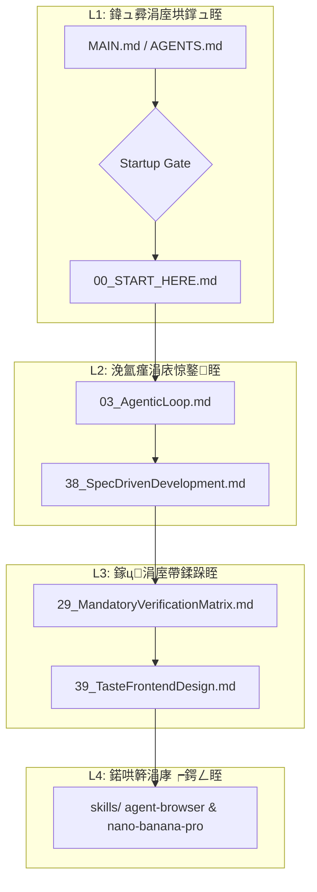

<!--


MANDATORY LOGIC GATE

Before making changes here, read `AGENTS.md` and `README.md` first.
Then follow the repository-declared logic entry chain, including `00_START_HERE.md`,
`modules/01_MasterLogic.md`, and `modules/15_LogicEntryChecklist.md` when applicable.

Before every new coding round, explicitly decide whether the current task extends
the previous coding round.
If it does not, explicitly ask whether to forget/compress context before continuing.

Treat this flow as a blocking gate, not as guidance, documentation, or a reminder.
Do not infer continuation by yourself.
Do not skip the context-reset question for efficiency.

Do not continue deeper reading, modify files, delete files, perform write actions,
or begin implementation before the logic-entry loop above has been completed.
-->

> `README.md` is the canonical English repository README and entry documentation. This file is retained as a legacy/reference document and is not part of the formal logic-entry chain.


# 馃寣 AgentLogic: 鏅鸿兘浣撶骇鏈湴鑷繘鍖栬鍒欏紩鎿?(V6.8.7)

[](https://github.com/UIhoshi/AgentLogic)
[](https://opensource.org/licenses/MIT)
[](./versions/AgentLogic_V6_8_7.md)

AgentLogic 鏄竴濂椾笓涓烘湰鍦?AI 缂栫爜瀹夸富锛堝 Codex, Claude Code, Gemini Pro锛夎璁＄殑**鍒嗗眰瑙勫垯寮曟搸**銆傚畠灏嗗杞細璇濊鑼冦€佸伐鍏烽閫夌瓥鐣ャ€佸畨鍏ㄦ矙绠辨嫤鎴強涓撲笟棰嗗煙鎵╁睍闆嗘垚鎵撳寘锛屼綔涓?AI 鏅鸿兘浣撶殑鈥滀富杩愯蹇冩櫤鈥濄€?

> [!IMPORTANT]
> **寮€鍙戝墠缃崱鐐?*锛氭湰浠撳簱鏄€昏緫鍩虹璁炬柦锛岃€岄潪鏅€氱殑涓氬姟椤圭洰銆?
> 鍦ㄨ繘琛屼换浣曢€昏緫淇敼鎴栨柊椤圭洰缁戝畾鍓嶏紝AI 鏅鸿兘浣?*蹇呴』**浠?`00_START_HERE.md` 涓鸿捣鐐癸紝瀹屾垚瀹屾暣鐨勯€昏緫閾鹃棴鐜嚜妫€銆?

---

## 馃殌 蹇€熷惎鍔ㄤ笌閮ㄧ讲

瀵逛簬鏈湴鐜鐨勮瘖鏂笌閮ㄧ讲锛岃涓ユ牸鎵ц浠ヤ笅鎸囦护锛?

| 鎿嶄綔姝ラ | 杩愯鎸囦护 (PowerShell) | 鏍稿績浣滅敤 |
| :--- | :--- | :--- |
| **1. 鐜璇婃柇** | `powershell -NoProfile -ExecutionPolicy Bypass -File .\scripts\doctor.ps1` | 妫€娴嬩粨搴撳仴搴峰害锛岃鍙栧厓鏁版嵁锛岀敓鎴愭帹鑽愬畨瑁呮寚浠?|
| **2. 涓€閿畨瑁?* | `powershell -NoProfile -ExecutionPolicy Bypass -File .\install.ps1 -TargetHost antigravity` | 娓呯悊鑰佹棫娈嬬暀閫昏緫锛屾瀯寤哄苟閮ㄧ讲褰撳墠瀹夸富瀵瑰簲鐨勮鍒欏寘 |
| **3. 鏈湴楠岃瘉** | `powershell -NoProfile -ExecutionPolicy Bypass -File .\scripts\maintainer-check.ps1` | 杩愯瀹夊叏涓庨摼鎺ュ畬澶囨€ф牎楠岋紝纭繚鍥涘眰鏋舵瀯鏃犲潖閾?|

---

## 馃彈锔?鏋舵瀯鐭╅樀涓庢ā鍧楁槧灏?(4-Layer Grid Matrix)

鏈粨搴撴嫆缁濈嚎鎬х殑瑙勫垯鍫嗙爩锛屽皢鎵€鏈夋ā鍧楁寜**鍥涘眰鎶借薄**杩涜鍒嗙骇娌荤悊锛岄伩鍏嶄笂涓嬫枃鑶ㄨ儉锛?



### 妯″潡璇︾粏娓呭崟

| 鎶借薄灞傜骇 | 鏍稿績鑱岃矗 | 鍖呭惈鐨勮鍒欐枃浠?/ 鐩綍 |
| :--- | :--- | :--- |
| **L1: Strategy & Entry**<br>(鎴樼暐涓庡叆鍙ｅ眰) | 纭珛 AI 鐨勮捣鎵嬪紡锛岃繘琛屼細璇濇寕璧?婵€娲讳互鍙婄幆澧冭嚜妫€銆?| - [00_START_HERE.md](./00_START_HERE.md) (璧锋墜寮?<br>- [MAIN.md](./MAIN.md) (瀹夸富缁戝畾鍏ュ彛)<br>- [AGENTS.md](./AGENTS.md) (鏅鸿兘浣撹鑼?<br>- [15_LogicEntryChecklist.md](./modules/15_LogicEntryChecklist.md) (鑷娓呭崟)<br>- [13_MandatoryLogicGateTemplate.md](./modules/13_MandatoryLogicGateTemplate.md) (寮哄埗鎷︽埅闂? |
| **L2: Session & Loop**<br>(浼氳瘽涓庡惊鐜眰) | 瑙勮寖澶氳疆瀵硅瘽涓殑鎬濈淮婕旇繘锛岄伩鍏?Vibe Coding (鐩茬洰鍐欎唬鐮?銆?| - [03_AgenticLoop.md](./modules/03_AgenticLoop.md) (鎵ц寰幆)<br>- [38_SpecDrivenDevelopment.md](./modules/38_V6_6_SpecDrivenDevelopment.md) (SDD 瑙勬牸椹卞姩鍏樁娈?<br>- [20_V6_5_RuntimeModes.md](./modules/20_V6_5_RuntimeModes.md) (杩愯妯″紡)<br>- [28_V6_5_TerminologyAndModuleBoundaries.md](./modules/28_V6_5_TerminologyAndModuleBoundaries.md) (瑙勫垯杈圭晫) |
| **L3: Control & Auditing**<br>(鎵ц涓庢帶鍒跺眰) | 鎷︽埅楂橀闄╂搷浣滐紝寤虹珛涓ユ牸鐨勭粨璁洪獙璇佺煩闃典笌浠ｇ爜璐ㄩ噺鑷鏈哄埗銆?| - [29_MandatoryVerificationMatrix.md](./modules/29_MandatoryVerificationMatrix.md) (寮洪獙璇佺煩闃?<br>- [39_TasteFrontendDesign.md](./modules/39_V6_6_TasteFrontendDesign.md) (瑙嗚鍝佸懗涓?UI 瀹¤)<br>- [30_ToolQuestionBoundaryMatrix.md](./modules/30_ToolQuestionBoundaryMatrix.md) (鎻愰棶鍑瘉杈圭晫)<br>- [31_ToolMisuseAndAntiPatternMatrix.md](./modules/31_ToolMisuseAndAntiPatternMatrix.md) (鍙嶆ā寮忕籂鍋? |
| **L4: Drivers & Skills**<br>(鍩哄簳涓庨┍鍔ㄥ眰) | 搴曞眰鍘熷瓙鎵ц椹卞姩涓庡彲绉绘鎶€鑳芥彃浠躲€傛敮鎸佷笂涓嬫枃鑱斿姩涓庤嚜绾犻敊銆?| - `skills/` (鍙Щ妞嶉鍩熸妧鑳藉寘)<br>  * [agent-browser](./skills/agent-browser/) (缃戦〉鍔ㄦ€佽嚜鍔ㄥ寲鎺у埗)<br>  * [nano-banana-pro](./skills/nano-banana-pro/) (Gemini 澶氭ā鎬佽瑙夊師鍨?<br>  * [self-improvement](./skills/self-improvement/) (鑷涔犱笌閿欒璁板綍)<br>- [35_V6_5_SkillGovernanceAndMandatoryUse.md](./modules/35_V6_5_SkillGovernanceAndMandatoryUse.md) (鎶€鑳芥不鐞嗚鍒? |

---

## 馃洜锔?鑷涔犱笌鎸佺画杩涘寲瑙勭害

鏈郴缁熶笉浠呮槸琚姩瑙勫垯锛屾洿鍏峰**鍔ㄦ€佽嚜绾犻敊涓庢矇娣€鑳藉姏**锛?

```
[绯荤粺鎶ラ敊 / 鐢ㄦ埛绾犲亸 / 鍙戠幇鏇翠匠瀹炶返]
       鈹?
       鈻?(1) 鑷姩璁板綍鑷?
  .learnings/ (LEARNINGS.md / ERRORS.md)
       鈹?
       鈻?(2) 瑙﹀彂鑷繘鍖栧垽瀹?(棰戞 >= 3)
  鎻愮偧鏍稿績瑙勫垯 鈹€鈹€鉃?鍐欏叆 CLAUDE.md / AGENTS.md
```

> [!TIP]
> **璁捐鍥惧墠缃‘璁ゅ伐浣滄祦**锛氬湪涓虹敤鎴峰紑鍙戜换浣?App 鐣岄潰鎴栫綉椤垫椂锛屾湰瑙勫垯浼氬己鍒舵垜鍏堜娇鐢ㄥ妯℃€佽瑙夋ā鍨嬬敓鎴愯璁℃晥鏋滃浘锛屽湪鎮ㄧ‘璁ゅ缇庤璁″悗鎵嶅紑濮嬪啓浠ｇ爜銆?

---

## 馃摎 澶栭儴鍙傝€冧笌鍊熼壌椤圭洰

AgentLogic 鐨勬紨杩涚涓嶅紑寮€婧愮ぞ鍖虹殑鍚彂銆傛垜浠湪璁捐涓繁搴﹀弬鑰冧簡浠ヤ笅浼樼椤圭洰锛?

| 寮€婧愰」鐩悕绉?| GitHub 浠撳簱 / 鏂囨。鍦板潃 | 鏍稿績鍊熼壌涓庤础鐚偣 |
| :--- | :--- | :--- |
| **Linux Kernel Map** | [makelinux/linux_kernel_map](https://github.com/makelinux/linux_kernel_map) | 鍚彂浜嗗洓灞傜煩闃靛紡鍦板浘缁撴瀯 ([40_AgentLogicSystemMap.md](./modules/40_AgentLogicSystemMap.md)) |
| **Agent Browser** | [vercel-labs/agent-browser](https://github.com/vercel-labs/agent-browser) | 鎻愪緵浜嗘櫤鑳戒綋绾у埆鐨?AOM 鏃犲ご娴忚鍣ㄤ氦浜掓柟妗?|
| **Nano Banana Pro** | [google-gemini/imagen](https://ai.google.dev/) | 甯︽潵浜嗗妯℃€佸墠缃瑙夌‘璁や笌瀹＄編鍗囩骇宸ヤ綔娴?|
| **Self-Improvement Agent** | [peterskoett/self-improving-agent](https://github.com/peterskoett/self-improving-agent) | 璐＄尞浜嗙粨鏋勫寲鏃ュ織鑷渷涓庨鍙戣鍒欐矇娣€鑷繘鍖栨鏋?|
| **Spec Kit** | [github/spec-kit](https://github.com/github/spec-kit) | SDD 瑙勬牸椹卞姩寮€鍙戝懆鏈熻璁′笌璐ㄩ噺濂戠害鑷 |
| **Taste Skill** | [Leonxlnx/taste-skill](https://github.com/Leonxlnx/taste-skill) | 鐗╃悊寮圭哀杩愬姩銆佽壊褰╂槑搴︽爣鍑嗕笌闃?slop 鎺掔増瑙勮寖 |
| **PM Skills (AI Shipping)** | [phuryn/pm-skills](https://github.com/phuryn/pm-skills) | 寮曞叆 AI 浜や粯涓庡彲璇勫鎬у璁?(SRA) 鏈哄埗锛岃鑼?vibe-coded 浜や粯浠?|
| **Ponytail (Lazy Dev)** | [DietrichGebert/ponytail](https://github.com/DietrichGebert/ponytail) | 寮曞叆 7 姝モ€滄渶鎳掕祫娣卞紑鍙戝紑鍙戦樁姊€濓紙YAGNI銆佸鐢ㄤ紭鍏堛€佸師鐢熶紭鍏堬級闃蹭唬鐮佽啫鑳€ |
| **Matt Pocock Skills** | [mattpocock/skills](https://github.com/mattpocock/skills) | 寮曞叆浜や簰寮忓崟姝?Grilling 鎷烽棶銆乣CONTEXT.md` 閫氱敤棰嗗煙璇嶆眹琛ㄤ笌 ADR 鍐崇瓥璁板綍 |
| **Cybersecurity Skills Router** | [zhaoxuya520/reverse-skill](https://github.com/zhaoxuya520/reverse-skill) | 寮曞叆鎭舵剰杞欢鍒嗘瀽銆丄PK 閫嗗悜銆佸墠绔弽娣锋穯瑙ｅ瘑鍜屽浐浠跺璁℃妧鑳借皟搴?|
| **Grok Build (瀵圭収鍙傝€?** | [xai-org/grok-build](https://github.com/xai-org/grok-build) | 瀵圭収鍒嗘瀽鏈嶅姟鍟嗕腑绔嬬殑杩愯鏃舵墽琛屻€佺姸鎬佷繚鐣欏帇缂╀互鍙婂畨鍏ㄦ嫆缁濊鐩栫瓥鐣?|
| **Graphify锛堝閮ㄤ唬鐮佸湴鍥惧弬鑰冿級** | [Graphify-Labs/graphify](https://github.com/Graphify-Labs/graphify) | 鎻愪緵鍙€夌殑鍙煡璇㈤」鐩浘璋变笌缁忕敤鎴峰悓鎰忕殑浠ｇ爜瑙嗗浘棰勮娴佺▼ |
| **MengTo Skills锛堝伐浣滄祦瀵圭収锛?* | [MengTo/Skills](https://github.com/MengTo/Skills) | 涓哄彲閫夌殑鍙傝€冪礌鏉愬埌鐣岄潰宸ヤ綔娴佹彁渚涢噰闆嗐€佹彁鍙栧拰楠岃瘉鏂规硶锛涗笉鐩存帴瀵煎叆澶栭儴鎶€鑳?|
| **OfficeCLI锛圤ffice 鏂囨。宸ヤ綔娴佸鐓э級** | [iOfficeAI/OfficeCLI](https://github.com/iOfficeAI/OfficeCLI) | 瀵圭敤鎴疯姹傜殑 Word/Excel/PowerPoint 鏂囦欢澶勭悊锛屽畾涔夌粡鍗曠嫭淇′换涓庡畨瑁呭悗鐨勫己鍒跺伐鍏疯矾绾匡紱涓嶅鍏ヤ簩杩涘埗銆乻kill 鎴栬繍琛屾椂 |
| **PixelRAG锛堣瑙夋枃妗ｅ伐浣滄祦瀵圭収锛?* | [StarTrail-org/PixelRAG](https://github.com/StarTrail-org/PixelRAG) | 瀹氫箟鍙€夎瑙夋枃妗ｅ彂鐜版斂绛栵紱涓嶅彇浠ｆ祻瑙堝櫒鎴栨埅鍥鹃獙璇?|
| **Firecrawl锛堝閮ㄩ噰闆嗗伐浣滄祦瀵圭収锛?* | [firecrawl/firecrawl](https://github.com/firecrawl/firecrawl) | 瀹氫箟缁忓悓鎰忕殑鍏紑缃戦〉閲囬泦鏀跨瓥锛涗笉鎵撳寘 API銆丼DK 鎴栨湇鍔?|
| **img2threejs锛堜氦浜掑紡 3D 缃戦〉宸ヤ綔娴佸鐓э級** | [img2threejs/img2threejs](https://github.com/img2threejs/img2threejs) | 涓虹粡鎵瑰噯鐨勫弬鑰冨浘绋嬪簭鍖?Three.js 妯″瀷閲嶅缓鎻愪緵鍙€夎矾绾匡紱涓嶆墦鍖?skill 鎴栬繍琛屾椂 |

---

## 鈿栵笍 缁存姢鍘熷垯涓庤竟鐣?

1. **閫昏緫鍖呯函绮规€?*锛氭湰浠撳簱鏄鍒欏厓鏁版嵁锛屼笉鑳藉啓鍏ュ叿浣撶殑涓氬姟椤圭洰浠ｇ爜銆?
2. **闃茬洸鐩墽琛?*锛欰I 鍔╃悊鍦ㄨ繘琛屽鏉傞噸鏋勬垨鏂规璁捐鍓嶏紝蹇呴』鍦?`.specify/` 涓嬪畬鎴?`spec.md` (瑙勬牸) 鍜?`plan.md` (鎶€鏈鍒?銆?
3. **鐗堟湰闅旂**锛氫慨鏀规牳蹇冩満鍒舵椂锛屽簲浼樺厛鍥炲啓 `versions/AgentLogic_V6_8_7.md`锛岀劧鍚庨噸鏂拌繍琛?`build-profile.ps1` 杩涜缂栬瘧閮ㄧ讲銆?
