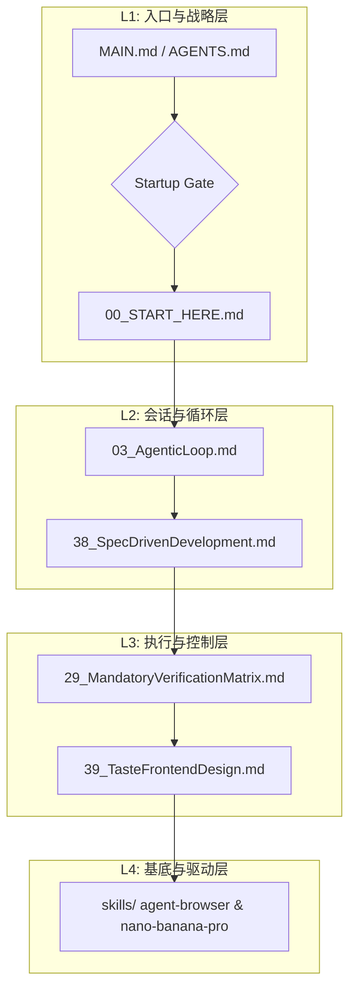

<!--


MANDATORY LOGIC GATE

Before making changes here, read `AGENTS.md` and `README.md` first.
Then follow the repository-declared logic entry chain, including `00_START_HERE.md`,
`modules/01_MasterLogic.md`, and `modules/15_LogicEntryChecklist.md` when applicable.

Before every new coding round, explicitly decide whether the current task extends
the previous coding round.
If it does not, explicitly ask whether to forget/compress context before continuing.

Treat this flow as a blocking gate, not as guidance, documentation, or a reminder.
Do not infer continuation by yourself.
Do not skip the context-reset question for efficiency.

Do not continue deeper reading, modify files, delete files, perform write actions,
or begin implementation before the logic-entry loop above has been completed.
-->

> `README.md` is the canonical English repository README and entry documentation. This file is retained as a legacy/reference document and is not part of the formal logic-entry chain.


# 🌌 AgentLogic: 智能体级本地自进化规则引擎 (V6.8.2)

[](https://github.com/UIhoshi/AgentLogic)
[](https://opensource.org/licenses/MIT)
[](./versions/AgentLogic_V6_8_2.md)

AgentLogic 是一套专为本地 AI 编码宿主（如 Codex, Claude Code, Gemini Pro）设计的**分层规则引擎**。它将多轮会话规范、工具首选策略、安全沙箱拦截及专业领域扩展集成打包，作为 AI 智能体的“主运行心智”。

> [!IMPORTANT]
> **开发前置卡点**：本仓库是逻辑基础设施，而非普通的业务项目。
> 在进行任何逻辑修改或新项目绑定前，AI 智能体**必须**以 `00_START_HERE.md` 为起点，完成完整的逻辑链闭环自检。

---

## 🚀 快速启动与部署

对于本地环境的诊断与部署，请严格执行以下指令：

| 操作步骤 | 运行指令 (PowerShell) | 核心作用 |
| :--- | :--- | :--- |
| **1. 环境诊断** | `powershell -NoProfile -ExecutionPolicy Bypass -File .\scripts\doctor.ps1` | 检测仓库健康度，读取元数据，生成推荐安装指令 |
| **2. 一键安装** | `powershell -NoProfile -ExecutionPolicy Bypass -File .\install.ps1 -TargetHost antigravity` | 清理老旧残留逻辑，构建并部署当前宿主对应的规则包 |
| **3. 本地验证** | `powershell -NoProfile -ExecutionPolicy Bypass -File .\scripts\maintainer-check.ps1` | 运行安全与链接完备性校验，确保四层架构无坏链 |

---

## 🏗️ 架构矩阵与模块映射 (4-Layer Grid Matrix)

本仓库拒绝线性的规则堆砌，将所有模块按**四层抽象**进行分级治理，避免上下文膨胀：



### 模块详细清单

| 抽象层级 | 核心职责 | 包含的规则文件 / 目录 |
| :--- | :--- | :--- |
| **L1: Strategy & Entry**<br>(战略与入口层) | 确立 AI 的起手式，进行会话挂起/激活以及环境自检。 | - [00_START_HERE.md](./00_START_HERE.md) (起手式)<br>- [MAIN.md](./MAIN.md) (宿主绑定入口)<br>- [AGENTS.md](./AGENTS.md) (智能体规范)<br>- [15_LogicEntryChecklist.md](./modules/15_LogicEntryChecklist.md) (自检清单)<br>- [13_MandatoryLogicGateTemplate.md](./modules/13_MandatoryLogicGateTemplate.md) (强制拦截门) |
| **L2: Session & Loop**<br>(会话与循环层) | 规范多轮对话中的思维演进，避免 Vibe Coding (盲目写代码)。 | - [03_AgenticLoop.md](./modules/03_AgenticLoop.md) (执行循环)<br>- [38_SpecDrivenDevelopment.md](./modules/38_V6_6_SpecDrivenDevelopment.md) (SDD 规格驱动六阶段)<br>- [20_V6_5_RuntimeModes.md](./modules/20_V6_5_RuntimeModes.md) (运行模式)<br>- [28_V6_5_TerminologyAndModuleBoundaries.md](./modules/28_V6_5_TerminologyAndModuleBoundaries.md) (规则边界) |
| **L3: Control & Auditing**<br>(执行与控制层) | 拦截高风险操作，建立严格的结论验证矩阵与代码质量自审机制。 | - [29_MandatoryVerificationMatrix.md](./modules/29_MandatoryVerificationMatrix.md) (强验证矩阵)<br>- [39_TasteFrontendDesign.md](./modules/39_V6_6_TasteFrontendDesign.md) (视觉品味与 UI 审计)<br>- [30_ToolQuestionBoundaryMatrix.md](./modules/30_ToolQuestionBoundaryMatrix.md) (提问凭证边界)<br>- [31_ToolMisuseAndAntiPatternMatrix.md](./modules/31_ToolMisuseAndAntiPatternMatrix.md) (反模式纠偏) |
| **L4: Drivers & Skills**<br>(基底与驱动层) | 底层原子执行驱动与可移植技能插件。支持上下文联动与自纠错。 | - `skills/` (可移植领域技能包)<br>  * [agent-browser](./skills/agent-browser/) (网页动态自动化控制)<br>  * [nano-banana-pro](./skills/nano-banana-pro/) (Gemini 多模态视觉原型)<br>  * [self-improvement](./skills/self-improvement/) (自学习与错误记录)<br>- [35_V6_5_SkillGovernanceAndMandatoryUse.md](./modules/35_V6_5_SkillGovernanceAndMandatoryUse.md) (技能治理规则) |

---

## 🛠️ 自学习与持续进化规约

本系统不仅是被动规则，更具备**动态自纠错与沉淀能力**：

```
[系统报错 / 用户纠偏 / 发现更佳实践]
       │
       ▼ (1) 自动记录至 
  .learnings/ (LEARNINGS.md / ERRORS.md)
       │
       ▼ (2) 触发自进化判定 (频次 >= 3)
  提炼核心规则 ──➔ 写入 CLAUDE.md / AGENTS.md
```

> [!TIP]
> **设计图前置确认工作流**：在为用户开发任何 App 界面或网页时，本规则会强制我先使用多模态视觉模型生成设计效果图，在您确认审美设计后才开始写代码。

---

## 📚 外部参考与借鉴项目

AgentLogic 的演进离不开开源社区的启发。我们在设计中深度参考了以下优秀项目：

| 开源项目名称 | GitHub 仓库 / 文档地址 | 核心借鉴与贡献点 |
| :--- | :--- | :--- |
| **Linux Kernel Map** | [makelinux/linux_kernel_map](https://github.com/makelinux/linux_kernel_map) | 启发了四层矩阵式地图结构 ([40_AgentLogicSystemMap.md](./modules/40_AgentLogicSystemMap.md)) |
| **Agent Browser** | [vercel-labs/agent-browser](https://github.com/vercel-labs/agent-browser) | 提供了智能体级别的 AOM 无头浏览器交互方案 |
| **Nano Banana Pro** | [google-gemini/imagen](https://ai.google.dev/) | 带来了多模态前置视觉确认与审美升级工作流 |
| **Self-Improvement Agent** | [peterskoett/self-improving-agent](https://github.com/peterskoett/self-improving-agent) | 贡献了结构化日志自省与频发规则沉淀自进化框架 |
| **Spec Kit** | [github/spec-kit](https://github.com/github/spec-kit) | SDD 规格驱动开发周期设计与质量契约自检 |
| **Taste Skill** | [Leonxlnx/taste-skill](https://github.com/Leonxlnx/taste-skill) | 物理弹簧运动、色彩明度标准与防 slop 排版规范 |
| **PM Skills (AI Shipping)** | [phuryn/pm-skills](https://github.com/phuryn/pm-skills) | 引入 AI 交付与可评审性审计 (SRA) 机制，规范 vibe-coded 交付件 |
| **Ponytail (Lazy Dev)** | [DietrichGebert/ponytail](https://github.com/DietrichGebert/ponytail) | 引入 7 步“最懒资深开发开发阶梯”（YAGNI、复用优先、原生优先）防代码膨胀 |
| **Matt Pocock Skills** | [mattpocock/skills](https://github.com/mattpocock/skills) | 引入交互式单步 Grilling 拷问、`CONTEXT.md` 通用领域词汇表与 ADR 决策记录 |
| **Cybersecurity Skills Router** | [zhaoxuya520/reverse-skill](https://github.com/zhaoxuya520/reverse-skill) | 引入恶意软件分析、APK 逆向、前端反混淆解密和固件审计技能调度 |
| **Grok Build (对照参考)** | [xai-org/grok-build](https://github.com/xai-org/grok-build) | 对照分析服务商中立的运行时执行、状态保留压缩以及安全拒绝覆盖策略 |
| **Graphify（外部代码地图参考）** | [Graphify-Labs/graphify](https://github.com/Graphify-Labs/graphify) | 提供可选的可查询项目图谱与经用户同意的代码视图预览流程 |

---

## ⚖️ 维护原则与边界

1. **逻辑包纯粹性**：本仓库是规则元数据，不能写入具体的业务项目代码。
2. **防盲目执行**：AI 助理在进行复杂重构或方案设计前，必须在 `.specify/` 下完成 `spec.md` (规格) 和 `plan.md` (技术规划)。
3. **版本隔离**：修改核心机制时，应优先回写 `versions/AgentLogic_V6_8_2.md`，然后重新运行 `build-profile.ps1` 进行编译部署。
