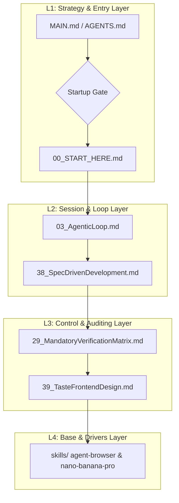

<!--
MANDATORY LOGIC GATE

Before making changes here, read `AGENTS.md` and `README.md` first.
Then follow the repository-declared logic entry chain, including `00_START_HERE.md`,
`modules/01_MasterLogic.md`, and `modules/15_LogicEntryChecklist.md` when applicable.

Before every new coding round, explicitly decide whether the current task extends
the previous coding round.
If it does not, explicitly ask whether to forget/compress context before continuing.

Treat this flow as a blocking gate, not as guidance, documentation, or a reminder.
Do not infer continuation by yourself.
Do not skip the context-reset question for efficiency.

Do not continue deeper reading, modify files, delete files, perform write actions,
or begin implementation before the logic-entry loop above has been completed.
-->

# 🌌 AgentLogic: Autonomous Evolving Rule Engine (V6.8.5)

[](https://github.com/UIhoshi/AgentLogic)
[](https://opensource.org/licenses/MIT)
[](./versions/AgentLogic_V6_8_5.md)

AgentLogic is a versioned primary-logic package designed to be pulled into local AI coding hosts (such as Codex, Claude Code, Gemini Pro) and used as their default operating mind. It consolidates multi-turn session workflows, tool selection matrix, security sandbox auditing, and dynamic domain extensions.

> [!IMPORTANT]
> **Repository Gating Warning**: This repository represents core logic infrastructure, not a generic business workspace.
> Before starting any code modifications or host installations, AI agents **MUST** anchor to `00_START_HERE.md` and complete the mandatory startup logic entry check.

---

## 🚀 Quick Start & Deployment

For local diagnostic runs and host deployment, execute the following commands in sequence:

| Step | PowerShell Command | Primary Purpose |
| :--- | :--- | :--- |
| **1. Diagnosis** | `powershell -NoProfile -ExecutionPolicy Bypass -File .\scripts\doctor.ps1` | Analyzes repository layout, checks manifests, and recommends installers |
| **2. Install** | `powershell -NoProfile -ExecutionPolicy Bypass -File .\install.ps1 -TargetHost antigravity` | Validates, builds, verifies, and deploys the fresh host-ready ruleset |
| **3. Validation** | `powershell -NoProfile -ExecutionPolicy Bypass -File .\scripts\maintainer-check.ps1` | Verifies structural link integrity and validates the compiled adapter bundles |

---

## 🏗️ 4-Layer Architecture Matrix (Grid & Subsystems)

We organize rules and code into a **4-layer progressive abstraction model** to prevent context budget bloat:



### Detailed Module Mapping

| Abstraction Layer | Primary Core Responsibility | Included Files / Directories |
| :--- | :--- | :--- |
| **L1: Strategy & Entry** | Defines entrypoints, environment injection, REPL startup gates, and context forget/reset rules. | - [00_START_HERE.md](./00_START_HERE.md) (起手式)<br>- [MAIN.md](./MAIN.md) (Stable Host Binding)<br>- [AGENTS.md](./AGENTS.md) (Agent Entry)<br>- [15_LogicEntryChecklist.md](./modules/15_LogicEntryChecklist.md) (Gate Checklist)<br>- [13_MandatoryLogicGateTemplate.md](./modules/13_MandatoryLogicGateTemplate.md) (Header Gating) |
| **L2: Session & Loop** | Manages the single-turn execution cycle, prevents vibe-coding, and structures the SDD lifecycle. | - [03_AgenticLoop.md](./modules/03_AgenticLoop.md) (Agentic Cycle)<br>- [38_SpecDrivenDevelopment.md](./modules/38_V6_6_SpecDrivenDevelopment.md) (SDD Lifecycle)<br>- [20_V6_5_RuntimeModes.md](./modules/20_V6_5_RuntimeModes.md) (Context Adaptation)<br>- [28_V6_5_TerminologyAndModuleBoundaries.md](./modules/28_V6_5_TerminologyAndModuleBoundaries.md) (Boundary Rules) |
| **L3: Control & Auditing** | Establishes high-friction verification rules, security-risk matrix, and visual frontend taste checks. | - [29_MandatoryVerificationMatrix.md](./modules/29_MandatoryVerificationMatrix.md) (Verification Matrix)<br>- [39_TasteFrontendDesign.md](./modules/39_V6_6_TasteFrontendDesign.md) (Aesthetic & Spacing Audit)<br>- [30_ToolQuestionBoundaryMatrix.md](./modules/30_ToolQuestionBoundaryMatrix.md) (Credential Boundary)<br>- [31_ToolMisuseAndAntiPatternMatrix.md](./modules/31_ToolMisuseAndAntiPatternMatrix.md) (Anti-Pattern Gating) |
| **L4: Base & Drivers** | Low-level command execution, raw tool controllers, portable skill files, and original frontend reference templates. | - `skills/` (Logic-Carried Domain Skills)<br>  * [agent-browser](./skills/agent-browser/) (Accessibility Browser CLI)<br>  * [nano-banana-pro](./skills/nano-banana-pro/) (Gemini Mockup Engine)<br>  * [self-improvement](./skills/self-improvement/) (Error Log & Self-Correction)<br>- [`templates/frontend/`](./templates/frontend/) (Original, unbranded UI starting points)<br>- [35_V6_5_SkillGovernanceAndMandatoryUse.md](./modules/35_V6_5_SkillGovernanceAndMandatoryUse.md) (Governance Rules) |

---

## 🛠️ Self-Improvement & Learning Feed

This rule package supports **automated self-evolution** and developer logging:

```
[Unexpected Error / User Correction / Best Practice Found]
                      │
                      ▼ (1) Automatically log to:
       .learnings/ (LEARNINGS.md / ERRORS.md)
                      │
                      ▼ (2) Exceeds threshold (Recurrence >= 3)
      Systemic rules extracted and merged into:
            CLAUDE.md / AGENTS.md
```

> [!TIP]
> **Design-First Prototyping Gate**: Net-new UI and substantial UI refactors require a text-to-image mockup and user review before implementation. A clearly classified small visual correction may skip a new mockup, but still requires visual verification; an explicit user opt-out always bypasses mockup approval.

## 🎨 Original Frontend Template Library

[`templates/frontend/`](./templates/frontend/) contains a small, dependency-free set of original,
unbranded HTML/CSS starting points: an editorial landing page, an analytics dashboard, and a
settings surface. They complement the Taste skill rather than replacing it: Taste governs visual
direction and verification, while the templates provide reusable structural baselines. They contain
no third-party images, fonts, logos, remote assets, or copied Open Design code.

---

## 📚 External References & Integrated Sources

During its evolutionary cycles, AgentLogic has integrated concepts and structures from the following open-source GitHub projects:

| Project Source | GitHub Repository | Primary Concept Integrated |
| :--- | :--- | :--- |
| **Linux Kernel Map** | [makelinux/linux_kernel_map](https://github.com/makelinux/linux_kernel_map) | Inspired the 4-layer structural system layout grid ([40_AgentLogicSystemMap.md](./modules/40_AgentLogicSystemMap.md)) |
| **Agent Browser** | [vercel-labs/agent-browser](https://github.com/vercel-labs/agent-browser) | Provided deterministic ref-based headless browser automation optimized for AI agents |
| **Nano Banana Pro** | [google-gemini/imagen](https://ai.google.dev/) | Supported high-fidelity visual UI mockup generation and layout prototyping for design-first workflows |
| **Self-Improvement Agent** | [peterskoett/self-improving-agent](https://github.com/peterskoett/self-improving-agent) | Enabled structured error logging, user-correction tracking, and recursive pattern hardening |
| **Spec Kit** | [github/spec-kit](https://github.com/github/spec-kit) | Formulated Spec-Driven Development (SDD) code-writing phases and task constraints |
| **Taste Skill** | [Leonxlnx/taste-skill](https://github.com/Leonxlnx/taste-skill) | Outlined physics spring animations, HSL palette controls, and typographical kerning guidelines |
| **PM Skills (AI Shipping)** | [phuryn/pm-skills](https://github.com/phuryn/pm-skills) | Establishes the AI Shipping & Reviewability Audit (SRA) protocol to restore human reviewability |
| **Ponytail (Lazy Dev)** | [DietrichGebert/ponytail](https://github.com/DietrichGebert/ponytail) | Enforces the 7-rung ladder (YAGNI, reuse, stdlib, native, dependency, one-line, min-code) to cut code bloat |
| **Matt Pocock Skills** | [mattpocock/skills](https://github.com/mattpocock/skills) | Integrates interactive grilling, `CONTEXT.md` vocabulary maps, and Architecture Decision Records (ADRs) |
| **Cybersecurity Skills Router** | [zhaoxuya520/reverse-skill](https://github.com/zhaoxuya520/reverse-skill) | Outlines malware analysis, APK reversing, frontend JS decryption, and firmware audit routing |
| **Grok Build (comparative reference)** | [xai-org/grok-build](https://github.com/xai-org/grok-build) | Compares provider-neutral runtime execution, state-preserving compaction, and deny-overrides policies |
| **Graphify (external code-map reference)** | [Graphify-Labs/graphify](https://github.com/Graphify-Labs/graphify) | Provides an optional queryable project graph and user-approved code-view preview workflow |
| **MengTo Skills (workflow comparison)** | [MengTo/Skills](https://github.com/MengTo/Skills) | Informs optional reference-to-interface capture, extraction, and verification workflows without importing external skills |
| **OfficeCLI (Office-document workflow comparison)** | [iOfficeAI/OfficeCLI](https://github.com/iOfficeAI/OfficeCLI) | Defines a mandatory route for requested Word/Excel/PowerPoint processing once separately trusted and installed; no binary, skill, or runtime is imported |
| **PixelRAG (visual-document workflow comparison)** | [StarTrail-org/PixelRAG](https://github.com/StarTrail-org/PixelRAG) | Defines an optional visual-document discovery policy; it does not replace browser or screenshot verification |
| **Firecrawl (external-collection workflow comparison)** | [firecrawl/firecrawl](https://github.com/firecrawl/firecrawl) | Defines an optional consent-bound public-web collection policy; no API, SDK, or service is bundled |
| **img2threejs (interactive 3D-web workflow comparison)** | [img2threejs/img2threejs](https://github.com/img2threejs/img2threejs) | Defines an optional reference-image-to-procedural-Three.js model route for approved interactive 3D web work; no skill or runtime is bundled |

---

## ⚖️ Maintenance Constraints

1. **Keep it Pure**: No business logic or project-specific implementations should be written into `AgentLogic` rule files.
2. **Specify Before Writing**: Always compile technical blueprints to `.specify/spec.md` and `.specify/plan.md` before touching code.
3. **Generate via Bundle**: Never edit `dist/` bundles manually. Always write updates to version files (e.g. `versions/AgentLogic_V6_8_5.md`), then run `build-profile.ps1` to rebuild the adapter targets.
## V6.8 Operational Integration

The default `core-enhanced` profile includes
[`modules/44_V6_8_GrokBuildOperationalIntegration.md`](./modules/44_V6_8_GrokBuildOperationalIntegration.md).
It translates useful provider-neutral patterns from
[`xai-org/grok-build`](https://github.com/xai-org/grok-build) into contracts for
rule discovery, session state, compaction, permissions, extension trust,
subagents, headless execution, memory freshness, and bounded background work.
These contracts complement—not replace—the existing SDD, Red-Team, SRA,
verification, and history-synchronization gates.

The same profile also includes
[`modules/45_V6_8_GraphifyCodeMapIntegration.md`](./modules/45_V6_8_GraphifyCodeMapIntegration.md).
It defines an optional Graph Preview Gate: substantial tasks ask the user at Converge/Ship
whether to generate a Graphify code view. Graphify is not installed or run automatically.

The enhanced profile also provides an optional
[`Reference-to-Interface Workflow`](./modules/47_V6_8_ReferenceToInterfaceWorkflow.md) for
permitted video, page, screenshot, and HTML references, plus an optional
[`img2threejs Interactive 3D Web Integration`](./modules/52_V6_8_Img2ThreeJs3DWebIntegration.md)
for approved reference-image model reconstruction, and a
[`Skill and Tool Routing`](./modules/48_V6_8_SkillAndToolRouting.md) matrix for selecting the
required evidence tool before the narrowest matching skill. Neither module installs or trusts
external skills automatically.

V6.8.5 keeps `core-enhanced` focused on high-frequency execution: start from the desired outcome,
select the native evidence/action tool, then add a specialist skill only when it materially helps.
The complete narrative governance set remains available through the `governance-reference` profile
for deep maintenance and policy audits.

## V6.8.5 Project-Native Knowledge Sync

Business projects synchronize their own concise operational facts and symbol-level navigation with code through tracked
`AGENTS.md`, `PROJECT_MAP.md`, `CODE_MAP.md`, and `.learnings/ERRORS.md`. `CODE_MAP.md` is the mandatory
text-first handover map; visual Graphify maps remain user-approved and optional. The global AgentLogic bundle is
not copied into projects. Before relying on those records, check remote freshness safely with
`git fetch --prune` and inspect the current branch/worktree; a pull remains a separate,
confirmed state change. `.specify/` and `docs/adr/` are conditional, while raw logs, secrets,
machine paths, private prompts, and default `graphify-out/` artifacts stay out of tracked
knowledge. See [Project-Native Knowledge Sync](./modules/46_V6_8_ProjectKnowledgeSync.md).
