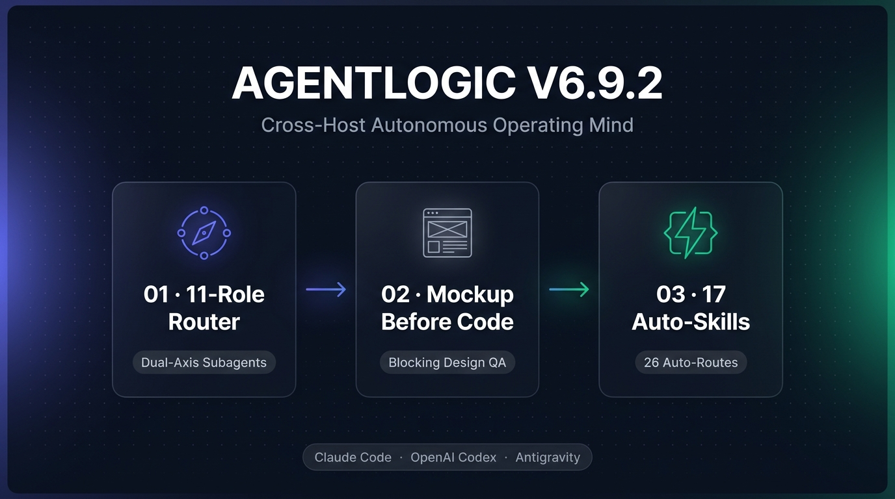
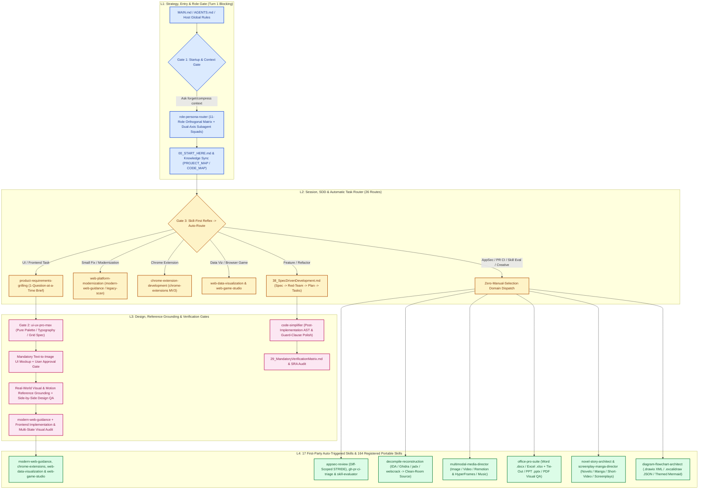
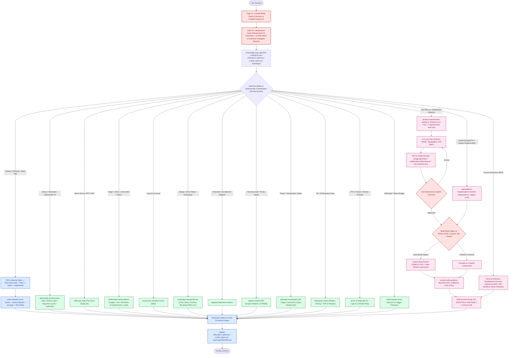
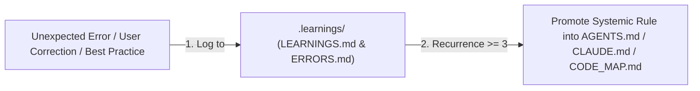

<!--
MANDATORY LOGIC GATE

Before making changes here, read `AGENTS.md` and `README.md` first.
Then follow the repository-declared logic entry chain, including `00_START_HERE.md`,
`modules/01_MasterLogic.md`, and `modules/15_LogicEntryChecklist.md` when applicable.

Before every new coding round, explicitly decide whether the current task extends
the previous coding round.
If it does not, explicitly ask whether to forget/compress context before continuing.

Treat this flow as a blocking gate, not as guidance, documentation, or a reminder.
Do not infer continuation by yourself.
Do not skip the context-reset question for efficiency.

Do not continue deeper reading, modify files, delete files, perform write actions,
or begin implementation before the logic-entry loop above has been completed.
-->

# 🌌 AgentLogic (`V6.9.3`)

**One autonomous operating mind for Claude Code, OpenAI Codex & Antigravity — Turn-1 11-role routing, mockup-before-code UI gates, and habitual skill-first execution.**

[](./versions/AgentLogic_V6_9_3.md)
[](./LICENSE)
[-indigo?style=flat-square)](#-17-built-in-auto-triggered-first-party-skills)
[](./contracts/role-personas.json)
[](#-30-second-zero-friction-install)
[](https://github.com/UIhoshi/AgentLogic/actions/workflows/validate-package.yml)

[中文文档 (`00_README.md`)](./00_README.md) · [Changelog](./CHANGELOG.md) · [Quick Start (`00_START_HERE.md`)](./00_START_HERE.md) · [Security Policy](./SECURITY.md)



### What Changes the Moment You Install It
1. **Stops Skipped Skills & Random Prompting**: Every task runs a Turn-1 **11-Role + Dual-Axis Subagent Squad** gate and a **3-second Skill-First Reflex scan** across **26 deterministic auto-routes** and **17 auto-deployed first-party skills** (164 registered portable skills total).
2. **Stops Blind Code-Dumping on Frontend UI**: Net-new UI and major refactors are **hard-blocked** until your agent finishes 1-question-at-a-time requirements grilling $\rightarrow$ derives an explicit palette/typography/grid spec (`ui-ux-pro-max`) $\rightarrow$ generates a **visual text-to-image mockup** for your approval $\rightarrow$ grounds real-world visuals/motion in downloaded references and verifies via **side-by-side Design QA (`P0`/`P1`/`P2`)**.
3. **One Single Source of Truth Across All 3 Coding Hosts**: Compiles into **Antigravity** (respecting its 24 KB rule limit), **Claude Code**, **OpenAI Codex** (plus native `.codex-plugin`), and **Generic**, while syncing project facts in `PROJECT_MAP.md`, `CODE_MAP.md`, and `.learnings/ERRORS.md`.

---

## 🚀 30-Second Zero-Friction Install

You don't need to manually wire rules or copy skill folders. Give your coding agent (**Antigravity**, **Claude Code**, or **OpenAI Codex**) this repository and ask:

> **Copy-Paste Prompt for Your Agent**:  
> `Read AGENT_INSTALL.md in this repository, install AgentLogic for my local host non-destructively, and verify with scripts/doctor.ps1.`

> [!NOTE]
> **Safe, Lean & Non-Destructive by Design**: The installer backs up existing user rules before updating, injects a compact **~11 KB bounded hook** (`<!-- BEGIN AGENTLOGIC HOOK --> ... <!-- END AGENTLOGIC HOOK -->`) pointing to on-disk reference bundles (never bloating Claude Code, Codex, or Antigravity prompts with 700+ KB dumps, and strictly respecting Antigravity's 24 KB limit), writes only plain-text Markdown/JSON/scripts, and never adds global hooks that hijack unrelated projects.

<details>
<summary><strong>Manual CLI Install (Windows PowerShell &amp; macOS / Linux Bash + Node.js) + Verification Commands</strong></summary>

#### Windows (PowerShell 5.1+ / `pwsh`)
```powershell
# 1. Inspect host targets & current layout
powershell -NoProfile -ExecutionPolicy Bypass -File .\scripts\doctor.ps1

# 2. Install for your host: antigravity | claude | codex | generic
powershell -NoProfile -ExecutionPolicy Bypass -File .\install.ps1 -TargetHost antigravity
powershell -NoProfile -ExecutionPolicy Bypass -File .\install.ps1 -TargetHost claude
powershell -NoProfile -ExecutionPolicy Bypass -File .\install.ps1 -TargetHost codex

# 3. Verify links, 164 skills, 26 routes, 11 roles & compiled bundles
powershell -NoProfile -ExecutionPolicy Bypass -File .\scripts\maintainer-check.ps1
```

#### macOS / Linux (`bash` with Node.js or `pwsh` — zero PowerShell setup needed)
```bash
# Install for your host: antigravity | claude | codex | generic
./install.sh --host claude
./install.sh --host codex
./install.sh --host antigravity

# Or invoke the zero-dependency Node.js installer directly on any OS:
node ./scripts/install.js --host claude
```
*(Uses `pwsh` when present and automatically falls back to pure `node` ([`scripts/install.js`](./scripts/install.js)); see [INSTALL.md](./INSTALL.md) and [AGENT_INSTALL.md](./AGENT_INSTALL.md) for custom targets and backup details.)*

</details>

---

## ⚡ Why AgentLogic? (vs. Vanilla AI & Ad-hoc Skills)

| Dimension | Vanilla AI (Raw Prompting) | Ad-hoc Skill Users | AgentLogic (`V6.9.3`) |
| :--- | :--- | :--- | :--- |
| **Skill Dispatch** | Relies on ad-hoc prompting; resets every new session | Requires remembering & manually invoking skills | **Skill-First Reflex Habit**: Turn 1 **11-role + Subagent squad router** + **26 deterministic auto-routes** & **17 auto-deployed first-party skills** |
| **Blocking Gates** | AI often skips planning and dumps boilerplate code | Soft suggestions only; skills can be bypassed | **Hard Blocking Gates**: 1-question requirements brief $\rightarrow$ `ui-ux-pro-max` spec $\rightarrow$ text-to-image mockup approval before UI code |
| **Real-World Visuals & Motion** | Hallucinates anatomy/geometry for SVGs & animations | No visual/motion reference enforcement | **Real-World Reference Grounding**: Requires real downloaded photos/GIFs/videos (`read_file`) + Z-depth + `?t=` audit before coding SVGs, Canvas, or animations |
| **Modern Web & Extensions** | Frequently defaults to legacy CSS/JS workarounds | Fragmented or outdated frontend guidance | **GoogleChrome/modern-web-guidance** (209 Baseline guides + `legacy-scan`) & **Chrome Extensions MV3** built into auto-routes |
| **Cross-Host Parity** | Rules diverge across Claude, Codex, and Antigravity | Separate configs per tool | **Single Source of Truth**: Compiles to Antigravity, Claude Code, Codex (`.codex-plugin`), and Generic + `PROJECT_MAP.md` / `CODE_MAP.md` sync |

---

## 🎯 17 Built-in Auto-Triggered First-Party Skills

Every installed host receives all **17 first-party skills** automatically—no manual `/skill` naming required:

| Domain | Auto-Triggered Skills | What They Enforce Automatically |
| :--- | :--- | :--- |
| **Orchestration & Quality** | [`role-persona-router`](./skills/productivity/role-persona-router/) · [`product-requirements-grilling`](./skills/productivity/product-requirements-grilling/) · [`code-simplifier`](./skills/engineering/code-simplifier/) · [`skill-evaluator`](./skills/engineering/skill-evaluator/) | Turn-1 11-role & dual-axis Subagent squads; 1-question requirements brief; post-impl AST/guard-clause polish; token-budget & link audits |
| **UI, Modern Web & Games** | [`ui-ux-pro-max`](./skills/design/ui-ux-pro-max/) · [`modern-web-guidance`](./skills/frontend/modern-web-guidance/) · [`chrome-extensions`](./skills/frontend/chrome-extensions/) · [`web-data-visualization`](./skills/frontend/web-data-visualization/) · [`web-game-studio`](./skills/frontend/web-game-studio/) | Palette/typography specs + mandatory text-to-image mockups + side-by-side Design QA; 209 modern web guides; MV3 extensions; charts/maps; Phaser/Three.js games |
| **Security, CI & Reversing** | [`appsec-review`](./skills/engineering/appsec-review/) · [`gh-pr-ci-triage`](./skills/engineering/gh-pr-ci-triage/) · [`decompile-reconstruction`](./skills/engineering/decompile-reconstruction/) · [`diagram-flowchart-architect`](./skills/engineering/diagram-flowchart-architect/) | Diff-scoped STRIDE & tri-state security verdicts; `gh` CLI CI/PR review triage; clean-room binary/bundle recovery; `.drawio` / `.excalidraw` / Mermaid |
| **Office, Media & Storytelling** | [`office-pro-suite`](./skills/productivity/office-pro-suite/) · [`multimodal-media-director`](./skills/creative/multimodal-media-director/) · [`novel-story-architect`](./skills/creative/novel-story-architect/) · [`screenplay-manga-director`](./skills/creative/screenplay-manga-director/) | Executive `.docx`/`.xlsx`/`.pptx`/`.pdf` (tie-out & visual QA); Image/Veo/Remotion/HyperFrames/Music; `.story-bible/` novels; manga panels, 0–3s hook short-video & micro-drama production packs |

---

## 🏛️ 4-Layer Architecture & V6.9.3 Autonomous Execution Flow

Rules, blocking gates, and auto-triggered capabilities are organized into a **4-layer progressive abstraction model** so every host executes the same deterministic workflow:



<details>
<summary><strong>🔍 Expand Full End-to-End Execution &amp; 26-Route Blocking Gate Flowchart</strong></summary>



</details>

### Detailed Module Mapping

| Abstraction Layer | Primary Core Responsibility | Included Files / Directories |
| :--- | :--- | :--- |
| **L1: Strategy & Entry** | Defines entrypoints, Turn 1 context-reset confirmation, autonomous `#1` 11-role recommendation & dual-axis Subagent squads (`role-persona-router`), and project-native knowledge sync. | - [00_START_HERE.md](./00_START_HERE.md) (起手式)<br>- [MAIN.md](./MAIN.md) (Stable Host Binding)<br>- [AGENTS.md](./AGENTS.md) (Agent Entry)<br>- [01_MasterLogic.md](./modules/01_MasterLogic.md) (Master Layer Spine)<br>- [15_LogicEntryChecklist.md](./modules/15_LogicEntryChecklist.md) (Gate Checklist)<br>- [54_V6_9_RoleAndMultimodalCreativeGovernance.md](./modules/54_V6_9_RoleAndMultimodalCreativeGovernance.md) (V6.9 Role & Creative Gates)<br>- [role-personas.json](./contracts/role-personas.json) (11-Role + Subagent Contract) |
| **L2: Session & Loop** | Manages the single-turn execution cycle, single-question requirements grilling, SDD lifecycle, and 26-route Skill-First Reflex zero-manual-selection dispatch. | - [03_AgenticLoop.md](./modules/03_AgenticLoop.md) (Agentic Cycle)<br>- [38_SpecDrivenDevelopment.md](./modules/38_V6_6_SpecDrivenDevelopment.md) (SDD Lifecycle)<br>- [48_V6_8_SkillAndToolRouting.md](./modules/48_V6_8_SkillAndToolRouting.md) (Autonomous Skill & Tool Routing)<br>- [53_V6_8_ProgrammingLevelSkillEnforcement.md](./modules/53_V6_8_ProgrammingLevelSkillEnforcement.md) (Skill Enforcement State Machine) |
| **L3: Control & Auditing** | Establishes pure UI/UX design-first + mandatory text-to-image mockup gating, side-by-side Design QA, post-implementation code simplification, `skill-evaluator` / `scripts/eval-skills.ps1` auditing, and verification matrices. | - [29_MandatoryVerificationMatrix.md](./modules/29_MandatoryVerificationMatrix.md) (Verification Matrix)<br>- [39_TasteFrontendDesign.md](./modules/39_V6_6_TasteFrontendDesign.md) (Aesthetic, Spacing & Side-by-Side Design QA Audit)<br>- [30_ToolQuestionBoundaryMatrix.md](./modules/30_ToolQuestionBoundaryMatrix.md) (Credential Boundary)<br>- [31_ToolMisuseAndAntiPatternMatrix.md](./modules/31_ToolMisuseAndAntiPatternMatrix.md) (Anti-Pattern Gating) |
| **L4: Base & Drivers** | 17 first-party auto-deployed domain skills across all hosts (`~/.gemini/skills`, `~/.claude/skills`, `~/.codex/skills`), 164 portable skills, 11 role personas (`contracts/role-personas.json`), Codex plugin bundle, and original UI templates. | - `skills/` (17 First-Party Auto-Triggered Skills + 164 Registered Portable Skills)<br>  * [role-persona-router](./skills/productivity/role-persona-router/) (Turn 1 11-Role Recommendation & Dual-Axis Subagent Squads)<br>  * [product-requirements-grilling](./skills/productivity/product-requirements-grilling/) (Single-Question Requirements Brief)<br>  * [ui-ux-pro-max](./skills/design/ui-ux-pro-max/) (Pure UI/UX Design Spec + Mandatory Text-to-Image Coupling)<br>  * [modern-web-guidance](./skills/frontend/modern-web-guidance/) (Modern Web Platform APIs, Baseline Compatibility, CWV & `legacy-scan`)<br>  * [chrome-extensions](./skills/frontend/chrome-extensions/) (Manifest V3 Browser Extensions & Chrome Web Store Publishing)<br>  * [web-data-visualization](./skills/frontend/web-data-visualization/) (Truthful Charts, Dashboards, Maps, D3/Vega/Canvas2D & Dual-Viewport QA)<br>  * [web-game-studio](./skills/frontend/web-game-studio/) (2D Phaser/Canvas2D & 3D Three.js/R3F Browser Games & Playtest)<br>  * [multimodal-media-director](./skills/creative/multimodal-media-director/) (Text-to-Image / Video Storyboard / Remotion & HyperFrames / Music Production)<br>  * [office-pro-suite](./skills/productivity/office-pro-suite/) (Executive Word `.docx`, Excel `.xlsx` + Tie-Out, PowerPoint `.pptx` & PDF `.pdf` Visual QA)<br>  * [novel-story-architect](./skills/creative/novel-story-architect/) (`.story-bible/` Continuity & Anti-AI-Cliché Fiction Engine)<br>  * [screenplay-manga-director](./skills/creative/screenplay-manga-director/) (Manga/Webtoon Panels, 0–3s Hook Short-Video Tables & Film/Animation Screenplays)<br>  * [diagram-flowchart-architect](./skills/engineering/diagram-flowchart-architect/) (`.drawio` XML, `.excalidraw` JSON & Themed Mermaid)<br>  * [appsec-review](./skills/engineering/appsec-review/) (Diff-Scoped AppSec Review, Tri-State Verdicts, STRIDE & Ownership Map)<br>  * [gh-pr-ci-triage](./skills/engineering/gh-pr-ci-triage/) (GitHub Actions CI Failure Logs & PR Review Resolution via `gh` CLI)<br>  * [skill-evaluator](./skills/engineering/skill-evaluator/) (Skill Quality, Trigger Precision, Link & Token-Budget Evaluation)<br>  * [code-simplifier](./skills/engineering/code-simplifier/) (Auto Post-Implementation Code Refinement & AST Rewrite)<br>  * [decompile-reconstruction](./skills/engineering/decompile-reconstruction/) (Auto Decompilation & Clean-Room Source Reconstruction)<br>- [`templates/frontend/`](./templates/frontend/) (Original, unbranded UI starting points) |

---

## 🛠️ Self-Improvement & Learning Feed

This rule package supports **automated self-evolution** and developer logging:



> [!TIP]
> **Pure Design + Mandatory Text-to-Image Mockup Gate (`ui-ux-pro-max`)**: Net-new UI and substantial UI refactors MUST first complete single-question requirements grilling, derive a pure `ui-ux-pro-max` visual design specification (industry palette, font pairing, spatial grid), and generate a **text-to-image mockup** for user approval before any frontend code is written.

## 🎨 Original Frontend Template Library

[`templates/frontend/`](./templates/frontend/) contains a small, dependency-free set of original, unbranded HTML/CSS starting points: an editorial landing page, an analytics dashboard, and a settings surface. They complement `ui-ux-pro-max` and Taste governance rather than replacing them: `ui-ux-pro-max` governs pure visual design specification and mandatory text-to-image mockup synthesis, while the templates provide reusable structural baselines. They contain no third-party images, fonts, logos, remote assets, or copied Open Design code.

---

## 📚 External References & Integrated Sources

During its evolutionary cycles, AgentLogic has integrated concepts and structures from **44** open-source references (**42** registered & CI-verified in [versions/AgentLogic_V6_9_3.md](./versions/AgentLogic_V6_9_3.md) Section 4 plus 2 foundational architectural inspirations):

| Project Source | GitHub Repository | Primary Concept Integrated |
| :--- | :--- | :--- |
| **Linux Kernel Map** | [makelinux/linux_kernel_map](https://github.com/makelinux/linux_kernel_map) | Inspired the 4-layer structural system layout grid ([40_AgentLogicSystemMap.md](./modules/40_AgentLogicSystemMap.md)) |
| **Agent Browser** | [vercel-labs/agent-browser](https://github.com/vercel-labs/agent-browser) | Provided deterministic ref-based headless browser automation optimized for AI agents |
| **Nano Banana Pro** | [google-gemini/imagen](https://ai.google.dev/) | Supported high-fidelity visual UI mockup generation and layout prototyping for design-first workflows |
| **Self-Improvement Agent** | [peterskoett/self-improving-agent](https://github.com/peterskoett/self-improving-agent) | Enabled structured error logging, user-correction tracking, and recursive pattern hardening |
| **Spec Kit** | [github/spec-kit](https://github.com/github/spec-kit) | Formulated Spec-Driven Development (SDD) code-writing phases and task constraints |
| **Taste Skill** | [Leonxlnx/taste-skill](https://github.com/Leonxlnx/taste-skill) | Outlined physics spring animations, HSL palette controls, and typographical kerning guidelines |
| **PM Skills (AI Shipping)** | [phuryn/pm-skills](https://github.com/phuryn/pm-skills) | Establishes the AI Shipping & Reviewability Audit (SRA) protocol to restore human reviewability |
| **Ponytail (Lazy Dev)** | [DietrichGebert/ponytail](https://github.com/DietrichGebert/ponytail) | Enforces the 7-rung ladder (YAGNI, reuse, stdlib, native, dependency, one-line, min-code) to cut code bloat |
| **Matt Pocock Skills** | [mattpocock/skills](https://github.com/mattpocock/skills) | Integrates interactive grilling, `CONTEXT.md` vocabulary maps, and Architecture Decision Records (ADRs) |
| **Cybersecurity Skills Router** | [zhaoxuya520/reverse-skill](https://github.com/zhaoxuya520/reverse-skill) | Outlines malware analysis, APK reversing, frontend JS decryption, and firmware audit routing |
| **Grok Build (comparative reference)** | [xai-org/grok-build](https://github.com/xai-org/grok-build) | Compares provider-neutral runtime execution, state-preserving compaction, and deny-overrides policies |
| **Graphify (external code-map reference)** | [Graphify-Labs/graphify](https://github.com/Graphify-Labs/graphify) | Provides an optional queryable project graph and user-approved code-view preview workflow |
| **MengTo Skills (workflow comparison)** | [MengTo/Skills](https://github.com/MengTo/Skills) | Informs optional reference-to-interface capture, extraction, and verification workflows without importing external skills |
| **OfficeCLI (Office-document workflow comparison)** | [iOfficeAI/OfficeCLI](https://github.com/iOfficeAI/OfficeCLI) | Defines a mandatory route for requested Word/Excel/PowerPoint processing once separately trusted and installed; no binary, skill, or runtime is imported |
| **PixelRAG (visual-document workflow comparison)** | [StarTrail-org/PixelRAG](https://github.com/StarTrail-org/PixelRAG) | Defines an optional visual-document discovery policy; it does not replace browser or screenshot verification |
| **Firecrawl (external-collection workflow comparison)** | [firecrawl/firecrawl](https://github.com/firecrawl/firecrawl) | Defines an optional consent-bound public-web collection policy; no API, SDK, or service is bundled |
| **img2threejs (interactive 3D-web workflow comparison)** | [img2threejs/img2threejs](https://github.com/img2threejs/img2threejs) | Defines an optional reference-image-to-procedural-Three.js model route for approved interactive 3D web work; no skill or runtime is bundled |
| **Reverse Engineer Anything (REA)** | [morluto/rea](https://github.com/morluto/rea) | Informs the automatic `decompile-reconstruction` clean-room binary/bundle source reconstruction workflow |
| **GhidraMCP** | [LaurieWired/GhidraMCP](https://github.com/LaurieWired/GhidraMCP) | Provides the open-source headless binary decompilation MCP benchmark for `decompile-reconstruction` |
| **Anthropic Official Claude Plugins (`code-simplifier`)** | [anthropics/claude-plugins-official](https://github.com/anthropics/claude-plugins-official) | Informs the automatic post-implementation `code-simplifier` complexity reduction and guard-clause refinement pass |
| **ast-grep** | [ast-grep/ast-grep](https://github.com/ast-grep/ast-grep) | Provides structural AST search and multi-site refactoring rules inside `code-simplifier` |
| **Superpowers** | [obra/superpowers](https://github.com/obra/superpowers) | Establishes the test-verified Red-Green-Refactor verification loop for code refinement |
| **UI/UX Pro Max Skill** | [nextlevelbuilder/ui-ux-pro-max-skill](https://github.com/nextlevelbuilder/ui-ux-pro-max-skill) | Provides pure UI/UX design-system intelligence (palettes, font pairings, layout grids) coupled with text-to-image mockups |
| **Modern Web Guidance** | [GoogleChrome/modern-web-guidance](https://github.com/GoogleChrome/modern-web-guidance) | Provides 209 modern web platform guides, Baseline compatibility, CWV/a11y rules, `legacy-scan`, and Chrome Extension MV3 best practices (`Apache-2.0`) |
| **Google Cloud GenMedia Creative Studio** | [GoogleCloudPlatform/vertex-ai-creative-studio](https://github.com/GoogleCloudPlatform/vertex-ai-creative-studio) | Informs multimodal Text-to-Image (Imagen), Text-to-Video (Veo), and Text-to-Music (Lyria) orchestration |
| **EachLabs Multimodal Skills** | [eachlabs/skills](https://github.com/eachlabs/skills) | Informs cross-model image, video storyboard, and audio generation workflows |
| **MiniMax MCP** | [MiniMax-AI/MiniMax-MCP](https://github.com/MiniMax-AI/MiniMax-MCP) | Provides Hailuo Video and MiniMax Music MCP generation reference patterns |
| **Claude Image Gen** | [guinacio/claude-image-gen](https://github.com/guinacio/claude-image-gen) | Informs aspect-ratio, reference-image guidance, and inpainting controls for UI and illustration mockups |
| **Anthropic Official Document Skills** | [anthropics/skills](https://github.com/anthropics/skills) | Establishes executive Word (.docx), dynamic-formula Excel (.xlsx), and action-title PowerPoint (.pptx) standards |
| **The Agency (agency-agents)** | [msitarzewski/agency-agents](https://github.com/msitarzewski/agency-agents) | Informs the 11 orthogonal specialist role personas in the Turn 1 Autonomous Role Recommendation Gate |
| **BMAD-METHOD** | [bmad-code-org/BMAD-METHOD](https://github.com/bmad-code-org/BMAD-METHOD) | Informs multi-role Lead + Supporting Squad orchestration and artifact handoffs |
| **Oh-Story ClaudeCode** | [zenstory-ai/oh-story-claudecode](https://github.com/zenstory-ai/oh-story-claudecode) | Informs web-novel pacing, Golden 3-Chapter structure, and anti-AI-cliche prose filtering |
| **Story Skills** | [danjdewhurst/story-skills](https://github.com/danjdewhurst/story-skills) | Establishes the `.story-bible/` continuity compiler and 4-point chapter audit |
| **Awesome Novel Studio** | [MJbae/awesome-novel-studio](https://github.com/MJbae/awesome-novel-studio) | Informs the 5-stage macro-to-scene-beat narrative drafting pipeline |
| **Draw.io Official MCP & Skill** | [jgraph/drawio-mcp](https://github.com/jgraph/drawio-mcp) | Provides native `.drawio` XML and orthogonal layout rules for enterprise flowcharts |
| **Agents365 Draw.io Skill** | [Agents365-ai/drawio-skill](https://github.com/Agents365-ai/drawio-skill) | Informs multi-view architecture, swimlane, and ER schema generation in `.drawio` |
| **Excalidraw Diagram Skill** | [coleam00/excalidraw-diagram-skill](https://github.com/coleam00/excalidraw-diagram-skill) | Informs color-zoned hand-drawn system design diagrams in `.excalidraw` |
| **OpenAI Plugins** | [openai/plugins](https://github.com/openai/plugins) | Informs MIT `web-data-visualization`, `skill-evaluator`, `web-game-studio`, Codex `.codex-plugin/plugin.json` packaging, and clean-room side-by-side Design QA / diff-scoped AppSec patterns |
| **OpenAI Skills (Deprecated Upstream)** | [openai/skills](https://github.com/openai/skills) | Provides Apache-2.0 AppSec (`security-best-practices` / `threat-model` / `ownership-map`), GitHub PR/CI (`gh-fix-ci` / `gh-address-comments`), and PDF (`pdf`) workflows |
| **Drama Skills** | [zenstory-ai/drama-skills](https://github.com/zenstory-ai/drama-skills) | Informs 5-doc short-drama episode spine, `REF`/`PLAN` branching, and independent `REV-xxx` cross-shot review with hook protection (`MIT`) |
| **Shuohao Skills** | [eternityspring/shuohao-skills](https://github.com/eternityspring/shuohao-skills) | Informs single-root character anchor sheets (`character-refs`) and top-down opening spatial blocking (`novel-staging`) (`Apache-2.0`) |
| **Muse Video Skill** | [LuoJiangYong/muse-video-skill](https://github.com/LuoJiangYong/muse-video-skill) | Informs six-role virtual film-crew Subagent squad, asset-ID reference chain, `visual_cause` art direction, and 6-part video prompt compilation (`MIT`) |
| **ManjuForge** | [mengxiujie/ManjuForge](https://github.com/mengxiujie/ManjuForge) | Informs serialized comic-drama memory split (identity invariants vs state variables) and Foreshadow Engine tracking (`MIT-0`) |
| **Hand-Drawn Video Prompts** | [kaomei/hand-drawn-video-prompts](https://github.com/kaomei/hand-drawn-video-prompts) | Informs 9:16 vertical hand-drawn/chibi storyboard framing and mobile safe-zone scripting (`MIT`) |

---

## ⚖️ Maintenance Constraints & Governance

> [!IMPORTANT]
> **Repository Gating Warning**: This repository is core logic infrastructure, not a generic business workspace. Before modifying rules or running host installations, AI agents **MUST** anchor to `00_START_HERE.md` and complete the mandatory startup logic-entry check.

1. **Keep it Pure**: No business logic or project-specific implementations should be written into `AgentLogic` rule files.
2. **Specify Before Writing**: For non-trivial features or refactors, compile technical blueprints under `.specify/` (`spec.md` / `plan.md`) before touching code.
3. **Generate via Bundle**: Never edit `dist/` bundles manually. Always write updates to version files (e.g. `versions/AgentLogic_V6_9_3.md`), then run `build-profile.ps1` to rebuild the adapter targets.

<details>
<summary><strong>Mandatory Version Update &amp; Pitfall Checklist (逻辑版本更新必查红线)</strong></summary>

Whenever promoting a version or updating core rules/skills, verify all items below (derived from `.learnings/ERRORS.md` historical post-mortems):
1. **11-File Version & Skill Sync**: Synchronize `manifest.json`, `versions/AgentLogic_<VER>.md`, `00_START_HERE.md`, `AGENTS.md`, `MAIN.md`, `README.md`, `00_README.md`, `AGENT_INSTALL.md`, `modules/01_MasterLogic.md` (L2 + L4 17 first-party skills), `modules/11_CrossDirectoryMap.md`, `modules/40_AgentLogicSystemMap.md`, `PROJECT_MAP.md`, `CODE_MAP.md`, and `CHANGELOG.md`.
2. **CP1252, UTF-8 & POSIX `pwsh` Redlines**: Keep all 27 operational `.ps1` scripts 100% pure ASCII without BOM (use `\uXXXX` escapes instead of literal `—` or CJK text), POSIX `pwsh`-compatible (`[IO.Path]::Combine(...)`, Core `pwsh` dispatch, `$HOME` fallback), passing both Windows and Ubuntu CI; always pass `-Encoding UTF8` to `Get-Content`; always write JSON/JS/MD using `[System.Text.UTF8Encoding]::new($false)` (no BOM, no `\u9225` CP936 mojibake).
3. **PowerShell & Antigravity Pitfalls**: Never use `$host` as a variable name; never use double-quoted `@"..."@` for Markdown containing backticks (`` `f `` becomes `\x0C`); always inline Gates 1–4 in `~/.gemini/GEMINI.md` (24 KB cap) and register `~/.gemini/skills`.
4. **Skill YAML & Defender Defanging**: Every `SKILL.md` must have YAML front-matter `name:`; security reference docs must defang raw `<script>` / `onerror=` strings to prevent Windows Defender false-positive quarantine.
5. **4-Host Rebuild, Local Sync & Tag Alignment**: Run `scripts/maintainer-check.ps1` (which automatically executes `check-logic-entry.js`, `eval-skills.ps1`, `audit-skill-duplicates.ps1 -FailOnCandidates`, `build-codex-plugin.ps1`, `validate-package.ps1` including `validate-role-personas.ps1` `default_skills` cross-validation, and all 3 regression suites: `test-skill-registry`, `test-skill-workflow-graph`, `test-skill-enforcement`), run `install.ps1` across `antigravity` / `claude` / `codex`, and align the Git release tag with the final `main` commit.

</details>

### V6.9.3 Role, Multimodal & Knowledge-Sync Governance

The default `core-enhanced` profile includes [`modules/54_V6_9_RoleAndMultimodalCreativeGovernance.md`](./modules/54_V6_9_RoleAndMultimodalCreativeGovernance.md) alongside [`modules/44_V6_8_GrokBuildOperationalIntegration.md`](./modules/44_V6_8_GrokBuildOperationalIntegration.md), [`modules/46_V6_8_ProjectKnowledgeSync.md`](./modules/46_V6_8_ProjectKnowledgeSync.md), [`modules/47_V6_8_ReferenceToInterfaceWorkflow.md`](./modules/47_V6_8_ReferenceToInterfaceWorkflow.md), [`modules/48_V6_8_SkillAndToolRouting.md`](./modules/48_V6_8_SkillAndToolRouting.md), [`modules/49_V6_8_AutonomousSkillEnforcement.md`](./modules/49_V6_8_AutonomousSkillEnforcement.md), [`modules/50_V6_8_ExternalResearchAndArtifactIntegration.md`](./modules/50_V6_8_ExternalResearchAndArtifactIntegration.md), [`modules/51_V6_8_AffordanceFirstToolUse.md`](./modules/51_V6_8_AffordanceFirstToolUse.md), [`modules/52_V6_8_Img2ThreeJs3DWebIntegration.md`](./modules/52_V6_8_Img2ThreeJs3DWebIntegration.md), and [`modules/53_V6_8_ProgrammingLevelSkillEnforcement.md`](./modules/53_V6_8_ProgrammingLevelSkillEnforcement.md) (with [`modules/45_V6_8_GraphifyCodeMapIntegration.md`](./modules/45_V6_8_GraphifyCodeMapIntegration.md) available in `governance-reference` / `optional_modules`).

- **Gate 1 (Turn 1 Context & 11-Role + Subagent Squad Gate)**: Every new project or non-continuation task triggers context-reset confirmation and [`role-persona-router`](./skills/productivity/role-persona-router/SKILL.md) (`contracts/role-personas.json`) to recommend the `#1` best-fit Lead Role (+ optional Subagent Squad for complex tasks) & present the 11-role selection menu.
- **Gate 2 (Pure UI Design + Mandatory Text-to-Image Coupling)**: Every net-new or substantially refactored UI runs [`product-requirements-grilling`](./skills/productivity/product-requirements-grilling/SKILL.md) $\rightarrow$ [`ui-ux-pro-max`](./skills/design/ui-ux-pro-max/SKILL.md) $\rightarrow$ [`multimodal-media-director`](./skills/creative/multimodal-media-director/SKILL.md) (`image-generator` / `nano-banana-pro`) and pauses for user approval before writing frontend code.
- **Gate 3 (Skill-First Reflex $\rightarrow$ Auto-Use Domain Capabilities)**: Compiled binaries/bundles trigger [`decompile-reconstruction`](./skills/engineering/decompile-reconstruction/SKILL.md); post-implementation code triggers [`code-simplifier`](./skills/engineering/code-simplifier/SKILL.md); HTML/CSS/DOM/CWV/a11y tasks trigger [`modern-web-guidance`](./skills/frontend/modern-web-guidance/SKILL.md); Manifest V3 browser extensions trigger [`chrome-extensions`](./skills/frontend/chrome-extensions/SKILL.md); `.docx`/`.xlsx`/`.pptx`/`.pdf` tasks trigger [`office-pro-suite`](./skills/productivity/office-pro-suite/SKILL.md); image/video/Remotion/music tasks trigger [`multimodal-media-director`](./skills/creative/multimodal-media-director/SKILL.md); fiction prose triggers [`novel-story-architect`](./skills/creative/novel-story-architect/SKILL.md); manga/short-video/screenplay scripts trigger [`screenplay-manga-director`](./skills/creative/screenplay-manga-director/SKILL.md); flowchart/architecture diagrams trigger [`diagram-flowchart-architect`](./skills/engineering/diagram-flowchart-architect/SKILL.md); security reviews/threat models trigger [`appsec-review`](./skills/engineering/appsec-review/SKILL.md); charts/dashboards/maps trigger [`web-data-visualization`](./skills/frontend/web-data-visualization/SKILL.md); browser games trigger [`web-game-studio`](./skills/frontend/web-game-studio/SKILL.md); GitHub PR/CI triage triggers [`gh-pr-ci-triage`](./skills/engineering/gh-pr-ci-triage/SKILL.md); and skill audits trigger [`skill-evaluator`](./skills/engineering/skill-evaluator/SKILL.md).
- **Project-Native Knowledge Sync**: Business projects synchronize operational facts and symbol-level navigation with code through tracked `AGENTS.md`, `PROJECT_MAP.md`, `CODE_MAP.md`, and `.learnings/ERRORS.md`. See [Project-Native Knowledge Sync](./modules/46_V6_8_ProjectKnowledgeSync.md), [CHANGELOG.md](./CHANGELOG.md), and [Module 53](./modules/53_V6_8_ProgrammingLevelSkillEnforcement.md).

---

## 🛡️ Security, Clean-Room & Third-Party Attribution Disclaimer

1. **Authorized Security & Clean-Room Research Only**: The reverse-engineering, binary triage (`decompile-reconstruction`), and security auditing routing rules (`skills/reverse-skill/`) included in this repository are strictly intended for **authorized security assessments, malware defense analysis, CTF competitions, educational research, and lawful clean-room interoperability reconstruction**. Users must obtain explicit legal authorization before analyzing any target binary, application, or system.
2. **Third-Party Open-Source Acknowledgments**: AgentLogic is a curated meta-governance framework that synthesizes methodologies and portable skill definitions from the open-source community (listed in the [External References & Integrated Sources](#-external-references--integrated-sources) table above). All vendored or adapted skill packages (`spec-kit`, `taste-skill`, `agent-browser`, `reverse-skill`, `modern-web-guidance`, etc.) retain their original open-source licenses (`MIT` / `Apache-2.0`) and copyright notices within their respective subdirectories.
3. **No Proprietary Runtime Bundling**: This repository contains only plain-text Markdown governance rules, JSON routing contracts, and PowerShell/Node validation scripts. It does not bundle any proprietary commercial CLI binaries or closed-source source code.
