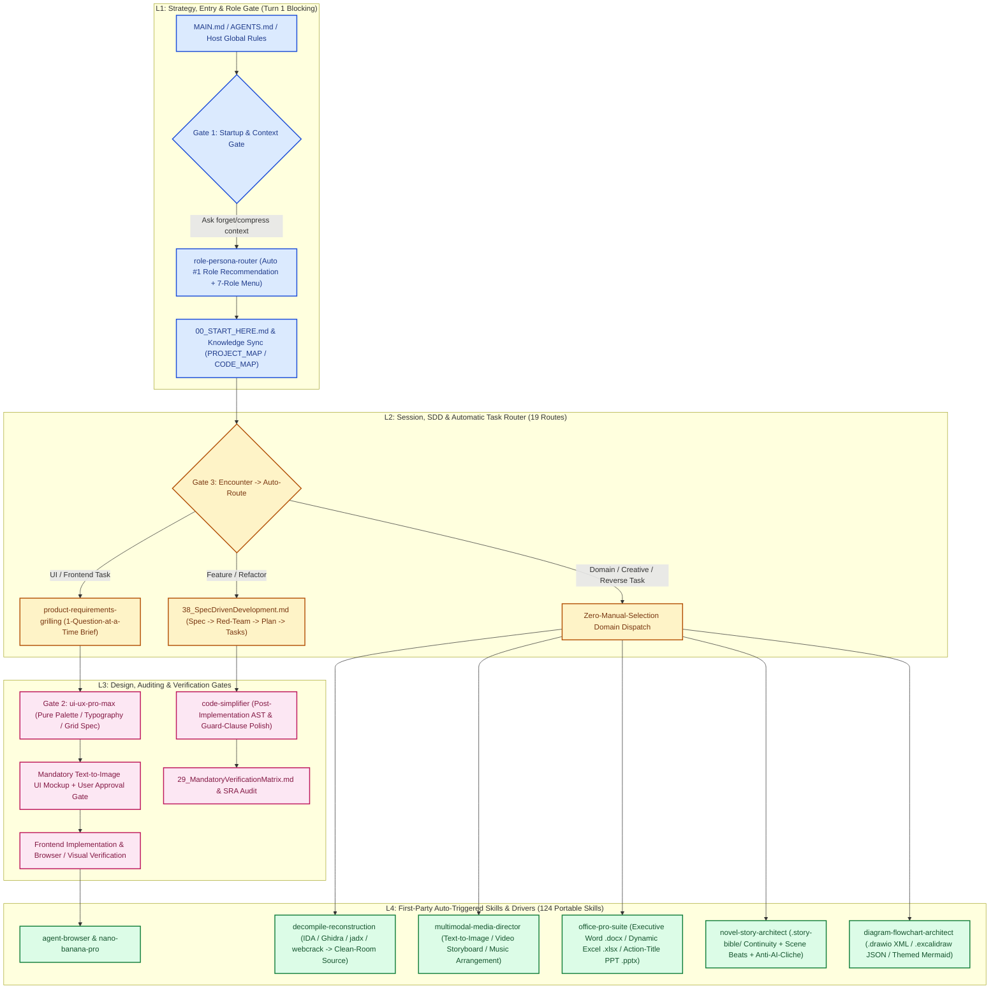
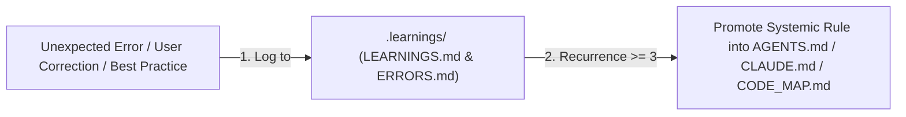

<!--
MANDATORY LOGIC GATE

Before making changes here, read `AGENTS.md` and `README.md` first.
Then follow the repository-declared logic entry chain, including `00_START_HERE.md`,
`modules/01_MasterLogic.md`, and `modules/15_LogicEntryChecklist.md` when applicable.

Before every new coding round, explicitly decide whether the current task extends
the previous coding round.
If it does not, explicitly ask whether to forget/compress context before continuing.

Treat this flow as a blocking gate, not as guidance, documentation, or a reminder.
Do not infer continuation by yourself.
Do not skip the context-reset question for efficiency.

Do not continue deeper reading, modify files, delete files, perform write actions,
or begin implementation before the logic-entry loop above has been completed.
-->

# 🌌 AgentLogic: Autonomous Evolving Rule Engine (V6.9.0)

AgentLogic is a versioned primary-logic package designed to be pulled into local AI coding hosts (**Antigravity / Gemini**, **Claude Code**, **OpenAI Codex / GPT**) and used as their default operating mind. It consolidates multi-turn session workflows, **Turn 1 autonomous role recommendation**, **pure UI/UX design + text-to-image mockup coupling**, **zero-manual-selection domain skill routing**, security sandbox auditing, and project-native knowledge synchronization.

> [!IMPORTANT]
> **Repository Gating Warning**: This repository represents core logic infrastructure, not a generic business workspace.
> Before starting any code modifications or host installations, AI agents **MUST** anchor to `00_START_HERE.md` and complete the mandatory startup logic entry check.

---

## 🚀 Quick Start & Deployment

For local diagnostic runs and cross-host deployment (`antigravity`, `claude`, `codex`), execute the following commands in sequence:

| Step | PowerShell Command | Primary Purpose |
| :--- | :--- | :--- |
| **1. Diagnosis** | `powershell -NoProfile -ExecutionPolicy Bypass -File .\scripts\doctor.ps1` | Analyzes repository layout, checks manifests, and recommends installers |
| **2. Install** | `powershell -NoProfile -ExecutionPolicy Bypass -File .\install.ps1 -TargetHost antigravity` | Validates, builds, verifies, and deploys the fresh host-ready ruleset and 9 first-party skills (`antigravity` / `claude` / `codex`) |
| **3. Validation** | `powershell -NoProfile -ExecutionPolicy Bypass -File .\scripts\maintainer-check.ps1` | Verifies structural link integrity, 124 registered skills, 19 auto-routes, and compiled adapter bundles |

---

## 🏛️ 4-Layer Architecture & V6.9 Autonomous Execution Flow

We organize rules, blocking gates, and auto-triggered capabilities into a **4-layer progressive abstraction model** so every host executes the same deterministic workflow without manual `/skill` selection:

### Detailed Module Mapping

| Abstraction Layer | Primary Core Responsibility | Included Files / Directories |
| :--- | :--- | :--- |
| **L1: Strategy & Entry** | Defines entrypoints, Turn 1 context-reset confirmation, autonomous `#1` role recommendation (`role-persona-router`), and project-native knowledge sync. | - [00_START_HERE.md](./00_START_HERE.md) (起手式) - [MAIN.md](./MAIN.md) (Stable Host Binding) - [AGENTS.md](./AGENTS.md) (Agent Entry) - [15_LogicEntryChecklist.md](./modules/15_LogicEntryChecklist.md) (Gate Checklist) - [54_V6_9_RoleAndMultimodalCreativeGovernance.md](./modules/54_V6_9_RoleAndMultimodalCreativeGovernance.md) (V6.9 Role & Creative Gates) |
| **L2: Session & Loop** | Manages the single-turn execution cycle, single-question requirements grilling, SDD lifecycle, and 19-route zero-manual-selection dispatch. | - [03_AgenticLoop.md](./modules/03_AgenticLoop.md) (Agentic Cycle) - [38_SpecDrivenDevelopment.md](./modules/38_V6_6_SpecDrivenDevelopment.md) (SDD Lifecycle) - [48_V6_8_SkillAndToolRouting.md](./modules/48_V6_8_SkillAndToolRouting.md) (Autonomous Skill & Tool Routing) - [53_V6_8_ProgrammingLevelSkillEnforcement.md](./modules/53_V6_8_ProgrammingLevelSkillEnforcement.md) (Skill Enforcement State Machine) |
| **L3: Control & Auditing** | Establishes pure UI/UX design-first + mandatory text-to-image mockup gating, post-implementation code simplification, and verification matrices. | - [29_MandatoryVerificationMatrix.md](./modules/29_MandatoryVerificationMatrix.md) (Verification Matrix) - [39_TasteFrontendDesign.md](./modules/39_V6_6_TasteFrontendDesign.md) (Aesthetic & Spacing Audit) - [30_ToolQuestionBoundaryMatrix.md](./modules/30_ToolQuestionBoundaryMatrix.md) (Credential Boundary) - [31_ToolMisuseAndAntiPatternMatrix.md](./modules/31_ToolMisuseAndAntiPatternMatrix.md) (Anti-Pattern Gating) |
| **L4: Base & Drivers** | 9 first-party auto-deployed domain skills across all hosts (`~/.gemini/skills`, `~/.claude/skills`, `~/.codex/skills`), 124 portable skills, and original UI templates. | - `skills/` (9 First-Party Auto-Triggered Skills + 124 Registered Portable Skills)   * [role-persona-router](./skills/productivity/role-persona-router/) (Turn 1 Role Recommendation & 7-Role Menu)   * [product-requirements-grilling](./skills/productivity/product-requirements-grilling/) (Single-Question Requirements Brief)   * [ui-ux-pro-max](./skills/design/ui-ux-pro-max/) (Pure UI/UX Design Spec + Mandatory Text-to-Image Coupling)   * [multimodal-media-director](./skills/creative/multimodal-media-director/) (Text-to-Image / Video Storyboard / Music Production)   * [office-pro-suite](./skills/productivity/office-pro-suite/) (Executive Word `.docx`, Excel `.xlsx`, PowerPoint `.pptx`)   * [novel-story-architect](./skills/creative/novel-story-architect/) (`.story-bible/` Continuity & Anti-AI-Cliché Fiction Engine)   * [diagram-flowchart-architect](./skills/engineering/diagram-flowchart-architect/) (`.drawio` XML, `.excalidraw` JSON & Themed Mermaid)   * [code-simplifier](./skills/engineering/code-simplifier/) (Auto Post-Implementation Code Refinement & AST Rewrite)   * [decompile-reconstruction](./skills/engineering/decompile-reconstruction/) (Auto Decompilation & Clean-Room Source Reconstruction) - [`templates/frontend/`](./templates/frontend/) (Original, unbranded UI starting points) |

---

## 🛠️ Self-Improvement & Learning Feed

This rule package supports **automated self-evolution** and developer logging:

> [!TIP]
> **Pure Design + Mandatory Text-to-Image Mockup Gate (`ui-ux-pro-max`)**: Net-new UI and substantial UI refactors MUST first complete single-question requirements grilling, derive a pure `ui-ux-pro-max` visual design specification (industry palette, font pairing, spatial grid), and generate a **text-to-image mockup** for user approval before any frontend code is written.

## 🎨 Original Frontend Template Library

[`templates/frontend/`](./templates/frontend/) contains a small, dependency-free set of original,
unbranded HTML/CSS starting points: an editorial landing page, an analytics dashboard, and a
settings surface. They complement `ui-ux-pro-max` and Taste governance rather than replacing them: `ui-ux-pro-max` governs pure visual design specification and mandatory text-to-image mockup synthesis, while the templates provide reusable structural baselines. They contain no third-party images, fonts, logos, remote assets, or copied Open Design code.

---

## 📚 External References & Integrated Sources

During its evolutionary cycles, AgentLogic has integrated concepts and structures from the following open-source GitHub projects:

| Project Source | GitHub Repository | Primary Concept Integrated |
| :--- | :--- | :--- |
| **Linux Kernel Map** | [makelinux/linux_kernel_map](https://github.com/makelinux/linux_kernel_map) | Inspired the 4-layer structural system layout grid ([40_AgentLogicSystemMap.md](./modules/40_AgentLogicSystemMap.md)) |
| **Agent Browser** | [vercel-labs/agent-browser](https://github.com/vercel-labs/agent-browser) | Provided deterministic ref-based headless browser automation optimized for AI agents |
| **Nano Banana Pro** | [google-gemini/imagen](https://ai.google.dev/) | Supported high-fidelity visual UI mockup generation and layout prototyping for design-first workflows |
| **Self-Improvement Agent** | [peterskoett/self-improving-agent](https://github.com/peterskoett/self-improving-agent) | Enabled structured error logging, user-correction tracking, and recursive pattern hardening |
| **Spec Kit** | [github/spec-kit](https://github.com/github/spec-kit) | Formulated Spec-Driven Development (SDD) code-writing phases and task constraints |
| **Taste Skill** | [Leonxlnx/taste-skill](https://github.com/Leonxlnx/taste-skill) | Outlined physics spring animations, HSL palette controls, and typographical kerning guidelines |
| **PM Skills (AI Shipping)** | [phuryn/pm-skills](https://github.com/phuryn/pm-skills) | Establishes the AI Shipping & Reviewability Audit (SRA) protocol to restore human reviewability |
| **Ponytail (Lazy Dev)** | [DietrichGebert/ponytail](https://github.com/DietrichGebert/ponytail) | Enforces the 7-rung ladder (YAGNI, reuse, stdlib, native, dependency, one-line, min-code) to cut code bloat |
| **Matt Pocock Skills** | [mattpocock/skills](https://github.com/mattpocock/skills) | Integrates interactive grilling, `CONTEXT.md` vocabulary maps, and Architecture Decision Records (ADRs) |
| **Cybersecurity Skills Router** | [zhaoxuya520/reverse-skill](https://github.com/zhaoxuya520/reverse-skill) | Outlines malware analysis, APK reversing, frontend JS decryption, and firmware audit routing |
| **Grok Build (comparative reference)** | [xai-org/grok-build](https://github.com/xai-org/grok-build) | Compares provider-neutral runtime execution, state-preserving compaction, and deny-overrides policies |
| **Graphify (external code-map reference)** | [Graphify-Labs/graphify](https://github.com/Graphify-Labs/graphify) | Provides an optional queryable project graph and user-approved code-view preview workflow |
| **MengTo Skills (workflow comparison)** | [MengTo/Skills](https://github.com/MengTo/Skills) | Informs optional reference-to-interface capture, extraction, and verification workflows without importing external skills |
| **OfficeCLI (Office-document workflow comparison)** | [iOfficeAI/OfficeCLI](https://github.com/iOfficeAI/OfficeCLI) | Defines a mandatory route for requested Word/Excel/PowerPoint processing once separately trusted and installed; no binary, skill, or runtime is imported |
| **PixelRAG (visual-document workflow comparison)** | [StarTrail-org/PixelRAG](https://github.com/StarTrail-org/PixelRAG) | Defines an optional visual-document discovery policy; it does not replace browser or screenshot verification |
| **Firecrawl (external-collection workflow comparison)** | [firecrawl/firecrawl](https://github.com/firecrawl/firecrawl) | Defines an optional consent-bound public-web collection policy; no API, SDK, or service is bundled |
| **img2threejs (interactive 3D-web workflow comparison)** | [img2threejs/img2threejs](https://github.com/img2threejs/img2threejs) | Defines an optional reference-image-to-procedural-Three.js model route for approved interactive 3D web work; no skill or runtime is bundled |
| **Reverse Engineer Anything (REA)** | [morluto/rea](https://github.com/morluto/rea) | Informs the automatic `decompile-reconstruction` clean-room binary/bundle source reconstruction workflow |
| **GhidraMCP** | [LaurieWired/GhidraMCP](https://github.com/LaurieWired/GhidraMCP) | Provides the open-source headless binary decompilation MCP benchmark for `decompile-reconstruction` |
| **Anthropic Official Claude Plugins (`code-simplifier`)** | [anthropics/claude-plugins-official](https://github.com/anthropics/claude-plugins-official) | Informs the automatic post-implementation `code-simplifier` complexity reduction and guard-clause refinement pass |
| **ast-grep** | [ast-grep/ast-grep](https://github.com/ast-grep/ast-grep) | Provides structural AST search and multi-site refactoring rules inside `code-simplifier` |
| **Superpowers** | [obra/superpowers](https://github.com/obra/superpowers) | Establishes the test-verified Red-Green-Refactor verification loop for code refinement |
| **UI/UX Pro Max Skill** | [nextlevelbuilder/ui-ux-pro-max-skill](https://github.com/nextlevelbuilder/ui-ux-pro-max-skill) | Provides pure UI/UX design-system intelligence (palettes, font pairings, layout grids) coupled with text-to-image mockups |
| **Google Cloud GenMedia Creative Studio** | [GoogleCloudPlatform/vertex-ai-creative-studio](https://github.com/GoogleCloudPlatform/vertex-ai-creative-studio) | Informs multimodal Text-to-Image (Imagen), Text-to-Video (Veo), and Text-to-Music (Lyria) orchestration |
| **EachLabs Multimodal Skills** | [eachlabs/skills](https://github.com/eachlabs/skills) | Informs cross-model image, video storyboard, and audio generation workflows |
| **MiniMax MCP** | [MiniMax-AI/MiniMax-MCP](https://github.com/MiniMax-AI/MiniMax-MCP) | Provides Hailuo Video and MiniMax Music MCP generation reference patterns |
| **Claude Image Gen** | [guinacio/claude-image-gen](https://github.com/guinacio/claude-image-gen) | Informs aspect-ratio, reference-image guidance, and inpainting controls for UI and illustration mockups |
| **Anthropic Official Document Skills** | [anthropics/skills](https://github.com/anthropics/skills) | Establishes executive Word (.docx), dynamic-formula Excel (.xlsx), and action-title PowerPoint (.pptx) standards |
| **The Agency (agency-agents)** | [msitarzewski/agency-agents](https://github.com/msitarzewski/agency-agents) | Informs the 7 specialist role personas in the Turn 1 Autonomous Role Recommendation Gate |
| **BMAD-METHOD** | [bmad-code-org/BMAD-METHOD](https://github.com/bmad-code-org/BMAD-METHOD) | Informs multi-role Lead + Supporting Squad orchestration and artifact handoffs |
| **Oh-Story ClaudeCode** | [zenstory-ai/oh-story-claudecode](https://github.com/zenstory-ai/oh-story-claudecode) | Informs web-novel pacing, Golden 3-Chapter structure, and anti-AI-cliche prose filtering |
| **Story Skills** | [danjdewhurst/story-skills](https://github.com/danjdewhurst/story-skills) | Establishes the `.story-bible/` continuity compiler and 4-point chapter audit |
| **Awesome Novel Studio** | [MJbae/awesome-novel-studio](https://github.com/MJbae/awesome-novel-studio) | Informs the 5-stage macro-to-scene-beat narrative drafting pipeline |
| **Draw.io Official MCP & Skill** | [jgraph/drawio-mcp](https://github.com/jgraph/drawio-mcp) | Provides native `.drawio` XML and orthogonal layout rules for enterprise flowcharts |
| **Agents365 Draw.io Skill** | [Agents365-ai/drawio-skill](https://github.com/Agents365-ai/drawio-skill) | Informs multi-view architecture, swimlane, and ER schema generation in `.drawio` |
| **Excalidraw Diagram Skill** | [coleam00/excalidraw-diagram-skill](https://github.com/coleam00/excalidraw-diagram-skill) | Informs color-zoned hand-drawn system design diagrams in `.excalidraw` |

---

## ⚖️ Maintenance Constraints

1. **Keep it Pure**: No business logic or project-specific implementations should be written into `AgentLogic` rule files.
2. **Specify Before Writing**: Always compile technical blueprints to `.specify/spec.md` and `.specify/plan.md` before touching code.
3. **Generate via Bundle**: Never edit `dist/` bundles manually. Always write updates to version files (e.g. `versions/AgentLogic_V6_9_0.md`), then run `build-profile.ps1` to rebuild the adapter targets.

> [!IMPORTANT]
> **Mandatory Version Update & Pitfall Checklist (逻辑版本更新必查红线)**:
> Whenever promoting a version or updating core rules/skills, you **MUST** check and synchronize all items below (derived from `.learnings/ERRORS.md` historical post-mortems):
> 1. **11-File Version & Skill Sync**: Synchronize `manifest.json`, `versions/AgentLogic_<VER>.md`, `00_START_HERE.md`, `AGENTS.md`, `MAIN.md`, `README.md`, `00_README.md`, `AGENT_INSTALL.md`, `modules/01_MasterLogic.md` (L2 + L4 9 first-party skills), `modules/11_CrossDirectoryMap.md`, `modules/40_AgentLogicSystemMap.md`, `PROJECT_MAP.md`, `CODE_MAP.md`, and `CHANGELOG.md`.
> 2. **CP1252 & UTF-8 Encoding Redlines**: Keep all operational `.ps1` scripts 100% pure ASCII without BOM (use `\uXXXX` escapes instead of literal `—` or CJK text); always pass `-Encoding UTF8` to `Get-Content`; always write JSON/JS/MD using `[System.Text.UTF8Encoding]::new($false)` (no BOM, no `\u9225` CP936 mojibake).
> 3. **PowerShell & Antigravity Pitfalls**: Never use `$host` as a variable name; never use double-quoted `@"..."@` for Markdown containing backticks (`` `f `` becomes `\x0C`); always inline Gates 1–4 in `~/.gemini/GEMINI.md` (24 KB cap) and register `~/.gemini/skills`.
> 4. **Skill YAML & Defender Defanging**: Every `SKILL.md` must have YAML front-matter `name:`; security reference docs must defang raw `<script>` / `onerror=` strings to prevent Windows Defender false-positive quarantine.
> 5. **4-Host Rebuild, Local Sync & Tag Alignment**: Run `scripts/maintainer-check.ps1` + `scripts/audit-skill-duplicates.ps1 -FailOnCandidates`, run `install.ps1` across `antigravity` / `claude` / `codex`, and align the Git release tag with the final `main` commit.

## V6.9.0 Role & Multimodal Creative Governance

The default `core-enhanced` profile includes [`modules/54_V6_9_RoleAndMultimodalCreativeGovernance.md`](./modules/54_V6_9_RoleAndMultimodalCreativeGovernance.md) alongside [`modules/44_V6_8_GrokBuildOperationalIntegration.md`](./modules/44_V6_8_GrokBuildOperationalIntegration.md), [`modules/45_V6_8_GraphifyCodeMapIntegration.md`](./modules/45_V6_8_GraphifyCodeMapIntegration.md), [`modules/47_V6_8_ReferenceToInterfaceWorkflow.md`](./modules/47_V6_8_ReferenceToInterfaceWorkflow.md), [`modules/48_V6_8_SkillAndToolRouting.md`](./modules/48_V6_8_SkillAndToolRouting.md), [`modules/52_V6_8_Img2ThreeJs3DWebIntegration.md`](./modules/52_V6_8_Img2ThreeJs3DWebIntegration.md), and [`modules/53_V6_8_ProgrammingLevelSkillEnforcement.md`](./modules/53_V6_8_ProgrammingLevelSkillEnforcement.md).

- **Gate 1 (Turn 1 Context & Autonomous Role Gate)**: Every new project or non-continuation task triggers context-reset confirmation and [`role-persona-router`](./skills/productivity/role-persona-router/SKILL.md) to recommend the `#1` best-fit Lead Role + present a 7-role selection menu.
- **Gate 2 (Pure UI Design + Mandatory Text-to-Image Coupling)**: Every net-new or substantially refactored UI runs [`product-requirements-grilling`](./skills/productivity/product-requirements-grilling/SKILL.md) $\rightarrow$ [`ui-ux-pro-max`](./skills/design/ui-ux-pro-max/SKILL.md) $\rightarrow$ [`multimodal-media-director`](./skills/creative/multimodal-media-director/SKILL.md) (`image-generator` / `nano-banana-pro`) and pauses for user approval before writing frontend code.
- **Gate 3 (Encounter $\rightarrow$ Auto-Use Domain Capabilities)**: Compiled binaries/bundles trigger [`decompile-reconstruction`](./skills/engineering/decompile-reconstruction/SKILL.md); post-implementation code triggers [`code-simplifier`](./skills/engineering/code-simplifier/SKILL.md); `.docx`/`.xlsx`/`.pptx` tasks trigger [`office-pro-suite`](./skills/productivity/office-pro-suite/SKILL.md); image/video/music generation triggers [`multimodal-media-director`](./skills/creative/multimodal-media-director/SKILL.md); fiction/script tasks trigger [`novel-story-architect`](./skills/creative/novel-story-architect/SKILL.md); flowchart/architecture diagrams trigger [`diagram-flowchart-architect`](./skills/engineering/diagram-flowchart-architect/SKILL.md).

## V6.9.0 Project-Native Knowledge Sync & Skill Enforcement

Business projects synchronize their own concise operational facts and symbol-level navigation with code through tracked `AGENTS.md`, `PROJECT_MAP.md`, `CODE_MAP.md`, and `.learnings/ERRORS.md`. See [Project-Native Knowledge Sync](./modules/46_V6_8_ProjectKnowledgeSync.md), [CHANGELOG.md](./CHANGELOG.md), and [Module 53](./modules/53_V6_8_ProgrammingLevelSkillEnforcement.md).

---

## 🛡️ Security, Clean-Room & Third-Party Attribution Disclaimer

1. **Authorized Security & Clean-Room Research Only**: The reverse-engineering, binary triage (`decompile-reconstruction`), and security auditing routing rules (`skills/reverse-skill/`) included in this repository are strictly intended for **authorized security assessments, malware defense analysis, CTF competitions, educational research, and lawful clean-room interoperability reconstruction**. Users must obtain explicit legal authorization before analyzing any target binary, application, or system.
2. **Third-Party Open-Source Acknowledgments**: AgentLogic is a curated meta-governance framework that synthesizes methodologies and portable skill definitions from the open-source community (listed in the [External References & Integrated Sources](#-external-references--integrated-sources) table above). All vendored or adapted skill packages (`spec-kit`, `taste-skill`, `agent-browser`, `reverse-skill`, etc.) retain their original open-source licenses (`MIT` / `Apache-2.0`) and copyright notices within their respective subdirectories.
3. **No Proprietary Runtime Bundling**: This repository contains only plain-text Markdown governance rules, JSON routing contracts, and PowerShell/Node validation scripts. It does not bundle any proprietary commercial CLI binaries or closed-source source code.

