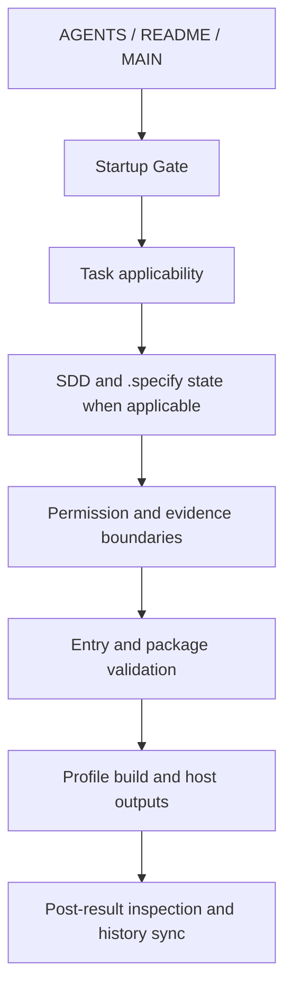

<!--
MANDATORY LOGIC GATE

Before making changes here, read `AGENTS.md` and `README.md` first.
Then follow the repository-declared logic entry chain, including `00_START_HERE.md`,
`modules/01_MasterLogic.md`, and `modules/15_LogicEntryChecklist.md` when applicable.

Before every new coding round, explicitly decide whether the current task extends
the previous coding round. If it does not, explicitly ask whether to forget/compress context.

This is a blocking gate. Do not begin implementation before it is complete.
-->

# AgentLogic System Map

This four-layer map is a repository map for the portable AgentLogic method layer. The Linux
kernel map is an analogy only; it does not imply that this repository contains a runtime CLI
implementation or the source tree of another project.

| Layer | Entry / lifecycle | Capability / tools | Governance / evidence | State / output |
|---|---|---|---|---|
| **L1 Strategy & Entry** | `00_START_HERE.md`, `AGENTS.md`, `MAIN.md` | `README.md`, `AGENT_INSTALL.md`, `INSTALL.md` | `modules/15_LogicEntryChecklist.md`, `modules/13_MandatoryLogicGateTemplate.md` | `manifest.json` |
| **L2 Session & Lifecycle** | `modules/01_MasterLogic.md`, `modules/03_AgenticLoop.md`, `versions/AgentLogic_V6_8_1.md` | `modules/38_V6_6_SpecDrivenDevelopment.md`, `spec-kit/`, `.specify/` | `modules/12_AgentEnforcement.md`, `modules/44_V6_8_GrokBuildOperationalIntegration.md` | `.specify/spec.md`, `.specify/plan.md`, `.specify/tasks.md` |
| **L3 Execution & Control** | `adapters/`, `install.ps1`, `install.sh` | `skills/`, `scripts/build-profile.ps1` | `modules/05_PermissionsAndSafety.md`, `modules/23_V6_5_PermissionAndOutputPipeline.md`, `modules/29_MandatoryVerificationMatrix.md`, `modules/30_ToolQuestionBoundaryMatrix.md`, `modules/31_ToolMisuseAndAntiPatternMatrix.md` | `scripts/check-logic-entry.js`, `scripts/validate-package.ps1` |
| **L4 Base & Reference** | `reference/`, historical `versions/` files | `skills/`, `spec-kit/` | `modules/35_V6_5_SkillGovernanceAndMandatoryUse.md`, `modules/36_V6_5_SkillZoneSeparation.md`, `modules/41_V6_7_AIShippingAndReviewabilityAudit.md` | `dist/`, `modification_history/` sibling repository |

## Control flow

## UI branch

Formal UI implementation branches through `modules/39_V6_6_TasteFrontendDesign.md`: generate
a text-to-image preview, show it to the user, and wait for approval or explicit user opt-out
before writing UI code. UI completion still requires screenshot and parent-child layout-boundary
verification.

## Update rule

This map must be updated when the manifest, entry chain, host adapters, validation scripts,
profile outputs, or mandatory governance modules change. It must contain repository-relative
paths only; external comparisons belong in the relevant reference or research record.
