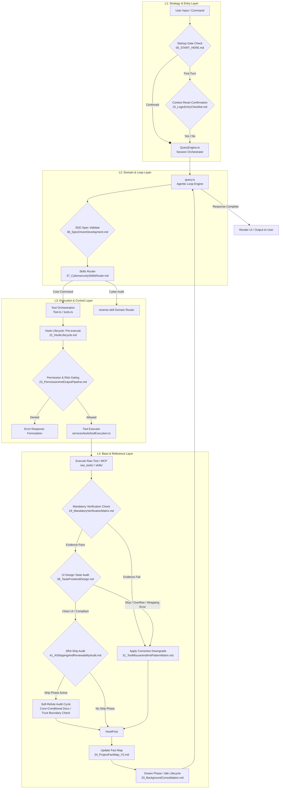

<!--
MANDATORY LOGIC GATE

Before making changes here, read `AGENTS.md` and `README.md` first.
Then follow the repository-declared logic entry chain, including `00_START_HERE.md`,
`modules/01_MasterLogic.md`, and `modules/15_LogicEntryChecklist.md` when applicable.

Before every new coding round, explicitly decide whether the current task extends
the previous coding round.
If it does not, explicitly ask whether to forget/compress context before continuing.

Treat this flow as a blocking gate, not as guidance, documentation, or a reminder.
Do not infer continuation by yourself.
Do not skip the context-reset question for efficiency.

Do not continue deeper reading, modify files, delete files, perform write actions,
or begin implementation before the logic-entry loop above has been completed.
-->

# AgentLogic System Map

本文件是受 Linux 内核直观架构图（[makelinux/linux_kernel_map](https://github.com/makelinux/linux_kernel_map)）启发而设计的 **Agentic CLI 架构与资源地图**。
它将整个 AgentLogic 的多轮会话、工具执行、权限控制、状态治理以及外部能力集成，整理成了一个包含**四层抽象（Rows）**与**五大子系统（Columns）**的网格地图，并用流程图描绘了单轮执行流中的交互路径。

---

## 1. 架构与资源网格地图 (Architecture Grid Matrix)

本矩阵将复杂的系统能力按“上下分层（层级）”和“左右分治（子系统）”的形式进行映射：

| 抽象层级 \ 子系统 | **会话与生命周期 (Session & Lifecycle)** | **能力与路由 (Capabilities & Routing)** | **工具与扩展 (Tools & Extensions)** | **安全与治理 (Security & Governance)** | **状态与记忆 (State & Memory)** |
| :--- | :--- | :--- | :--- | :--- | :--- |
| **L1: 战略与入口层 (Strategy & Entry)** | [cli.tsx](file:///REPO_ROOT_PLACEHOLDER/src/entrypoints/cli.tsx) [main.tsx](file:///REPO_ROOT_PLACEHOLDER/src/main.tsx) 启动与环境注入 | [00_START_HERE.md](file:///REPO_ROOT_PLACEHOLDER/00_START_HERE.md) [AGENTS.md](file:///REPO_ROOT_PLACEHOLDER/AGENTS.md) [MAIN.md](file:///REPO_ROOT_PLACEHOLDER/MAIN.md) 逻辑接入确认与宿主绑定入口 | [README.md](file:///REPO_ROOT_PLACEHOLDER/README.md) 主仓库文档导航说明 [11_CrossDirectoryMap.md](file:///REPO_ROOT_PLACEHOLDER/modules/11_CrossDirectoryMap.md) 代码跨目录地图 | [15_LogicEntryChecklist.md](file:///REPO_ROOT_PLACEHOLDER/modules/15_LogicEntryChecklist.md) 逻辑入口检查清单 [13_MandatoryLogicGateTemplate.md](file:///REPO_ROOT_PLACEHOLDER/modules/13_MandatoryLogicGateTemplate.md) 全局逻辑拦截检查 | `manifest.json` 静态元数据与打包配置文件配置 (运行时动态记忆层 N/A) |
| **L2: 领域与循环层 (Domain & Loop)** | [QueryEngine.ts](file:///REPO_ROOT_PLACEHOLDER/src/QueryEngine.ts) 多轮会话流编排 [20_V6_5_RuntimeModes.md](file:///REPO_ROOT_PLACEHOLDER/modules/20_V6_5_RuntimeModes.md) 运行环境感知与模式适配 | [query.ts](file:///REPO_ROOT_PLACEHOLDER/src/query.ts) 单轮 Agentic 执行循环 [28_V6_5_TerminologyAndModuleBoundaries.md](file:///REPO_ROOT_PLACEHOLDER/modules/28_V6_5_TerminologyAndModuleBoundaries.md) 标准术语与规则模块边界 | [38_V6_6_SpecDrivenDevelopment.md](file:///REPO_ROOT_PLACEHOLDER/modules/38_V6_6_SpecDrivenDevelopment.md) [spec-kit/](file:///REPO_ROOT_PLACEHOLDER/spec-kit/) 规格驱动开发 [21_V6_5_ToolUsageAndSelection.md](file:///REPO_ROOT_PLACEHOLDER/modules/21_V6_5_ToolUsageAndSelection.md) [24_V6_5_ToolUsageMatrix.md](file:///REPO_ROOT_PLACEHOLDER/modules/24_V6_5_ToolUsageMatrix.md) [25_V6_5_ToolCapabilityMapping.md](file:///REPO_ROOT_PLACEHOLDER/modules/25_V6_5_ToolCapabilityMapping.md) [26_V6_5_INDEX.md](file:///REPO_ROOT_PLACEHOLDER/modules/26_V6_5_INDEX.md) 工具首选矩阵与能力映射索引 | [12_AgentEnforcement.md](file:///REPO_ROOT_PLACEHOLDER/modules/12_AgentEnforcement.md) 行为强制审计与准则约束 | [32_V6_5_ContextAssemblyAndInstructionStacking.md](file:///REPO_ROOT_PLACEHOLDER/modules/32_V6_5_ContextAssemblyAndInstructionStacking.md) 上下文组装与指令堆叠 |
| **L3: 执行与控制层 (Execution & Control)** | [22_V6_5_HookLifecycle.md](file:///REPO_ROOT_PLACEHOLDER/modules/22_V6_5_HookLifecycle.md) Hook 生命周期管理 | [37_V6_6_CybersecuritySkillsRouter.md](file:///REPO_ROOT_PLACEHOLDER/modules/37_V6_6_CybersecuritySkillsRouter.md) 逆向安全与 CTF 路由分发 | [Tool.ts](file:///REPO_ROOT_PLACEHOLDER/src/Tool.ts) [tools.ts](file:///REPO_ROOT_PLACEHOLDER/src/tools.ts) 工具中介控制与动态组装 [39_V6_6_TasteFrontendDesign.md](file:///REPO_ROOT_PLACEHOLDER/modules/39_V6_6_TasteFrontendDesign.md) [skills/taste-skill/](file:///REPO_ROOT_PLACEHOLDER/skills/taste-skill/) 前端设计审美与 UI Slop 治理 | [23_V6_5_PermissionAndOutputPipeline.md](file:///REPO_ROOT_PLACEHOLDER/modules/23_V6_5_PermissionAndOutputPipeline.md) 权限拦截与输出管道 [30_ToolQuestionBoundaryMatrix.md](file:///REPO_ROOT_PLACEHOLDER/modules/30_ToolQuestionBoundaryMatrix.md) 提问凭证强度边界控制 [31_ToolMisuseAndAntiPatternMatrix.md](file:///REPO_ROOT_PLACEHOLDER/modules/31_ToolMisuseAndAntiPatternMatrix.md) 反模式校验失败与纠偏机制 [41_V6_7_AIShippingAndReviewabilityAudit.md](file:///REPO_ROOT_PLACEHOLDER/modules/41_V6_7_AIShippingAndReviewabilityAudit.md) SRA 交付审计与自证非校验 | [34_V6_5_ProjectFactMap_V2.md](file:///REPO_ROOT_PLACEHOLDER/modules/34_V6_5_ProjectFactMap_V2.md) [14_ProjectFactMapTemplate.md](file:///REPO_ROOT_PLACEHOLDER/modules/14_ProjectFactMapTemplate.md) 4-Tier 事实地图与标准模板 |
| **L4: 基底与参考层 (Base & Reference)** | [33_V6_5_BackgroundConsolidationAndIdleLifecycle.md](file:///REPO_ROOT_PLACEHOLDER/modules/33_V6_5_BackgroundConsolidationAndIdleLifecycle.md) 梦境期清理与后台巩固 | [35_V6_5_SkillGovernanceAndMandatoryUse.md](file:///REPO_ROOT_PLACEHOLDER/modules/35_V6_5_SkillGovernanceAndMandatoryUse.md) [36_V6_5_SkillZoneSeparation.md](file:///REPO_ROOT_PLACEHOLDER/modules/36_V6_5_SkillZoneSeparation.md) 技能去重与本地技能隔离 | [skills/](file:///REPO_ROOT_PLACEHOLDER/skills/) 领域扩展技能包 [raw_tools/](file:///REPO_ROOT_PLACEHOLDER/reference/raw_tools/) 原始工具层 | [27_V6_5_ToolPermissionRiskMatrix.md](file:///REPO_ROOT_PLACEHOLDER/modules/27_V6_5_ToolPermissionRiskMatrix.md) [29_MandatoryVerificationMatrix.md](file:///REPO_ROOT_PLACEHOLDER/modules/29_MandatoryVerificationMatrix.md) 权限风险与强制校验矩阵 [raw_permissions/](file:///REPO_ROOT_PLACEHOLDER/reference/raw_permissions/) 原始安全权限区 | `src/state/` 运行时会话状态状态机与本地落地层 |

---

## 2. 单轮 Agentic 执行流追踪地图 (Single Turn Flow Map)

当用户输入指令后，整个 Agentic Loop 会在系统各组件之间流动。以下是数据与控制流在不同抽象层级和子系统之间的流转图：

---

## 3. 架构设计对照：Linux Kernel Map 对比 AgentLogic

通过将经典的 `linux_kernel_map` 与 `AgentLogic` 进行架构对齐，我们可以发现两者在底层复杂系统抽象上的高度相似性，并为 Agentic 系统的演进提供指导：

| Linux 内核架构组件 | Agentic 架构组件 (AgentLogic) | 映射关系与设计哲学 |
| :--- | :--- | :--- |
| **System Call Interface (SCI)** | **CLI Entry & Logic Gates** | 系统调用的统一保护屏障。对应 `00_START_HERE.md` 与主逻辑拦截，确保所有输入与外部逻辑在调用核心引擎前经过安全和逻辑检查。 |
| **Process Scheduler (内核调度器)** | **QueryEngine & Agentic Loop** | 决定执行流如何流转、何时挂起、多轮循环的决策点。负责协调思考周期、模型调用与工具调用循环。 |
| **Virtual Memory System (虚存系统)** | **Context Assembly & fact map** | 内存虚拟化与映射。Agent 并不直接暴露原始的长历史，而是通过上下文组装和 Project Fact Map（4-Tier 事实地图）建立对当前项目的局部“事实视界”。 |
| **Virtual File System (VFS)** | **Tool Orchestration layer** | 对不同文件系统底座的抽象。对应 `Tool.ts` / `tools.ts`，无论是本地 Shell 工具还是网络 MCP 服务，在核心引擎看来都是统一的 Tool 抽象接口。 |
| **Device Drivers (驱动程序)** | **Raw Tools & Skills** | 直接操作硬件与外部环境的底层接口。对应 `raw_tools/` 和扩展 `skills/`（如 APK 逆向、 taste 设计），负责将系统的通用命令翻译为具体的原子执行。 |
| **Security Auditing (LSM / SELinux)**| **Permission Gate & Verification Matrix** | 强制访问控制与校验。对应 `23_PermissionAndOutputPipeline.md` 和 `29_MandatoryVerificationMatrix.md`，对越权命令进行拦截，对模型推论进行强制证据审计。 |

---

## 4. 后续追加与迭代准则 (Maintenance Guidelines)

1. **地图与代码强绑定**：
   - 任何新增 of `modules/*.md` 或 `src/` 下的核心源码模块，必须同步在此文件中的 **架构与资源网格地图** 的相应网格单元中进行注册。
   - 网格中注册的文件必须包含符合 Antigravity 规范的完整本地绝对路径或相对路径超链接（如 `file:///...`），实现 LXR 式的“一键直达源码”。

2. **执行流演进**：
   - 如果系统的单轮循环增加了新的前置/后置审计拦截点（例如：新增大模型安全护栏过滤、多代理协同编排等），必须同步更新本文件第 2 节的 **单轮 Agentic 执行流追踪地图** (Mermaid)。

3. **动态生成技术候选 (Future Enhancement)**：
   - 在未来的版本（如 V7.0）中，建议开发 `scripts/generate-system-map.js` 脚本，自动读取 `manifest.json` 中配置的 profile 和模块关系，动态渲染并导出本文件的 SVG 或 Markdown 网格图，降低人工维护的偏差。
